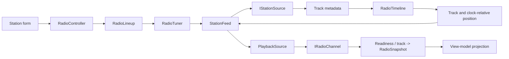
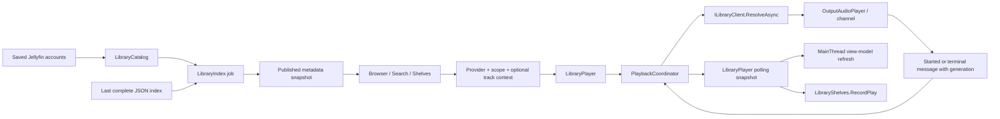
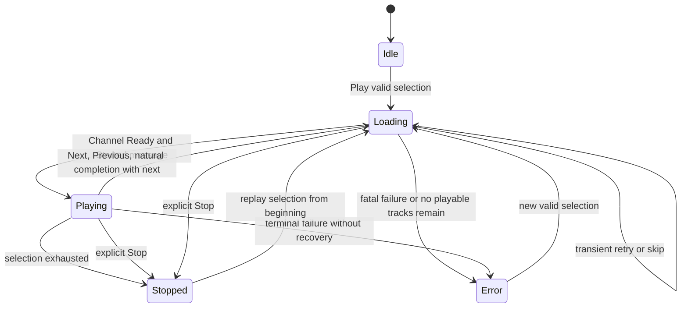

# Data flow and state management

[Overview](overview.md) | [Dependency composition](dependency-graph.md)

## Ownership map

| State | Owner and mutation boundary | Publication / lifetime |
|---|---|---|
| Authoritative lineup | [RadioController.cs](../../src/JellyJam.Core/Radio/RadioController.cs): load/edit/start/stop semaphore; RadioLineup replacement | Lineup plus Changed; persisted in stations.json. |
| Dial and volume | Same controller: Tune uses quantized hundredths; volume stored as float bits | Tuner signal or Changed; VolumeChanged reaches Library. Volume preference is saved by the settings VM. |
| Active Radio engine/output | RadioController | IsOn means tuner exists, not proof of audible samples. Stop cancels/awaits tuner then releases output and connections. |
| Feed neighborhood/reception | [RadioTuner.cs](../../src/JellyJam.Core/Radio/RadioTuner.cs): one coalesced signal reader | RadioSnapshot replaced with Volatile.Write. |
| Programme, stream, readiness, feed error | [StationFeed.cs](../../src/JellyJam.Core/Radio/StationFeed.cs): worker plus local lock | Callback signals tuner; feed disposed when outside neighborhood or Radio stops. |
| Displayed mode, last Library request | [PlayerShell.cs](../../src/JellyJam.Core/Playback/PlayerShell.cs) | Mode Changed does not switch audio; replay selection is memory-only. |
| Library session, random/repeat choices | [LibraryPlayer.cs](../../src/JellyJam.Core/Library/LibraryPlayer.cs): its own semaphore | LibrarySnapshot sampled every 250 ms; Changes mostly coalesced to second-level position differences. |
| Current track, sequence/history, failed IDs | [PlaybackCoordinator.cs](../../src/JellyJam.Core/Playback/PlaybackCoordinator.cs), [TrackSelector.cs](../../src/JellyJam.Core/Playback/TrackSelector.cs) | Coordinator command/event channel, generation-tagged workers; memory only in active Library use. |
| Provider/client cache | [LibraryCatalog.cs](../../src/JellyJam.Core/Library/LibraryCatalog.cs): lock plus lazy task per provider | Clients reused until account changes/removal is noticed on access; caller cancellation cancels waiting, not shared creation. |
| Metadata jobs and last complete scan | [LibraryIndex.cs](../../src/JellyJam.Core/Library/LibraryIndex.cs): lock and job tokens | Changed plus immutable-style snapshot; persist before replacement publication. |
| Navigation, list, back stack | [LibraryBrowser.cs](../../src/JellyJam.Core/Library/LibraryBrowser.cs): lock, cancellation, epoch | LibraryBrowseState/Changed; only provider preference persists. |
| Search text/results, edit fields, busy flags | [ViewModels](../../src/JellyJam.MAUI/ViewModels) | Presentation-owned mutable collections/properties; not authoritative playback state. |
| Favorites/recent albums | [LibraryShelves.cs](../../src/JellyJam.Core/Library/LibraryShelves.cs): state lock and separate write lock | Snapshot lists/Changed; deferred JSON writes, no flush API. |
| PCM, gains, sample counters | Platform channels and [RadioMixer.cs](../../src/JellyJam.Core/Audio/RadioMixer.cs) | Audio thread consumes samples; decoder fills bounded buffers. |
| Theme and decoration | [ThemeService.cs](../../src/JellyJam.MAUI/Services/ThemeService.cs), JsonThemeStore | Resource keys and theme/animation events; artwork color request version rejects stale results. |

Records and IReadOnlyList express snapshot usage but do not make every backing array deeply immutable. Consumers must not mutate collections received from these APIs.

## Two distinct data pipelines

Track metadata is not audio. PlaybackSource is a short-lived transport object that may contain tokens, stream/session identifiers, start position, or buffered frames; never treat it as a serializable view model.

## State transitions

This is the active Library lifecycle, not Radio's signal enum. LibrarySnapshot.IsActive is true for Loading/Playing only. Natural terminal state sets Finished before the session is released; explicit Stop does not manufacture a pause cursor.

Radio's independent signal is None / Connecting / Playing / Failed in [RadioTuner.cs](../../src/JellyJam.Core/Radio/RadioTuner.cs). A failed station can leave Radio on with static and the dial still usable.

## Persistence and restoration

All MAUI stores use FileSystem.AppDataDirectory from [MauiProgram.cs](../../src/JellyJam.MAUI/MauiProgram.cs). CLI uses its own directory convention. Paths below are relative to the selected host's data directory, not the repository.

| Data | Store / file or key | Restore semantics |
|---|---|---|
| Accounts, stations, last saved dial | [JsonStationStore.cs](../../src/JellyJam.Core/Configuration/JsonStationStore.cs): stations.json | Missing -> empty; invalid/unreadable -> error; version 1 normalized to 2. |
| Server tokens | [WindowsServerCredentialStore.cs](../../src/JellyJam.Infrastructure.Windows/Security/WindowsServerCredentialStore.cs): server-credentials.dat; [SecureServerCredentialStore.cs](../../src/JellyJam.MAUI/Services/SecureServerCredentialStore.cs): per-server SecureStorage keys | Not exported with settings. Missing login requires authentication. |
| Cached station programme | [JsonTrackListCache.cs](../../src/JellyJam.Core/Configuration/JsonTrackListCache.cs): track-lists.json | Cache-first for Jellyfin, Plex, Podcast; fresh programme can replace it at a boundary. Device is scanned rather than using this cache. |
| Measured episode lengths | [JsonTrackLengthStore.cs](../../src/JellyJam.Core/Configuration/JsonTrackLengthStore.cs): track-lengths.json | Reuse measured duration, not audio. |
| Browsable metadata | [JsonLibraryIndexStore.cs](../../src/JellyJam.Core/Configuration/JsonLibraryIndexStore.cs): library-index/hashed-account-key.json | Complete old snapshot remains available while scanning new sections. |
| Favorites/recent | [JsonLibraryShelfStore.cs](../../src/JellyJam.Core/Configuration/JsonLibraryShelfStore.cs): library-shelves.json | Loaded synchronously when shelves resolve; local metadata, not Jellyfin favorites. |
| Appearance | [JsonThemeStore.cs](../../src/JellyJam.Core/Configuration/JsonThemeStore.cs): theme.json | Default fallback with diagnostics, legacy appearance values normalized. |
| Shell/UI settings | MAUI Preferences in [RadioViewModel.cs](../../src/JellyJam.MAUI/ViewModels/RadioViewModel.cs), [MauiProgram.cs](../../src/JellyJam.MAUI/MauiProgram.cs), [StationsViewModel.cs](../../src/JellyJam.MAUI/ViewModels/StationsViewModel.cs) | `player.mode`, `library.provider`, `radio.volume`, `spectrum.enabled`, installation `plex.client-id`; guide has its own seen preference. Spectrum initialization currently requests true. |

No current Library session, selection history, stream URI, decoded audio, or displayed navigation stack is restored from these stores. Radio restores a frequency and recomputes the current broadcast from time. LastFrequency is saved on Stop; this does not replace the controller's in-memory Lineup record just to update that field.

## Concurrency details worth preserving while debugging

1. **Per-owner gates are not a global gate.** LibraryPlayer and RadioController serialize their own operations. A direct Radio start can interleave between the Library beforeStart callback and publication of its active session.
2. **Generations reject obsolete audio events.** Coordinator cancellation increments generation; each worker awaits the preceding worker before opening audio. Some worker retry-status publication occurs off the message loop, so not every snapshot write is literally in Handle.
3. **Navigation uses cancellation and identity.** BeginLoad increments epoch. Apply rejects results from older epochs. While Now Playing is shown, a load can update the saved return view instead of replacing the player.
4. **Pagination pins a snapshot.** Browser captures listIndex when navigating, so the next page does not mix old and refreshed metadata. Artist children deliberately go to the live client.
5. **Index publish follows durable save.** Save failure marks refresh Failed; an older snapshot is not replaced by an unpersisted candidate. Cancelled jobs are dropped without a join API.
6. **Shared fetch lifetime differs from waiter lifetime.** Catalog client creation, podcast feed loads, and now-playing artwork can outlive a cancelled caller; each uses its own lifetime/limit.
7. **UI events need dispatch.** Core Changed can fire on workers. MAUI view models post their projections to MainThread; a singleton does not confer thread affinity.
8. **File replacement is not a multi-store transaction.** A lineup write, token write, cache cleanup, and UI event have different commit points. See [configuration](subsystems/configuration.md).

## Errors and consistency boundaries

The code intentionally tolerates some cache/artwork failures, but authoritative lineup errors are blocking. SafeTask logs failures whose callers cannot receive them; it is not a user-visible error channel or durability acknowledgement. There is no global unit-of-work, central lifecycle join, or output-terminal-failure contract. See [failure investigation](investigations/errors-and-lifecycle.md) for exact branches rather than assuming all failures propagate uniformly.
