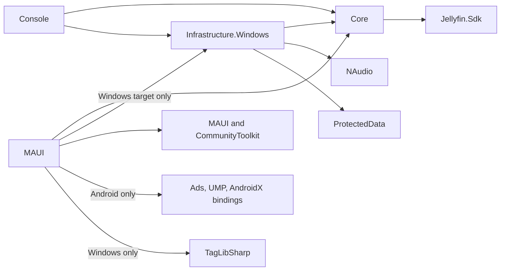
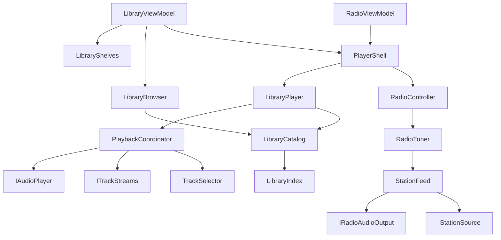
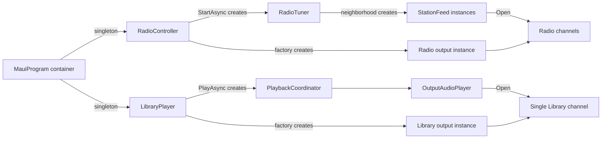

# Dependency and composition architecture

[Overview](overview.md) | [Startup](startup.md) | [State ownership](data-flow.md)

## Project references

Confirmed from the four production project files: [Core](../../src/JellyJam.Core/JellyJam.Core.csproj), [Windows infrastructure](../../src/JellyJam.Infrastructure.Windows/JellyJam.Infrastructure.Windows.csproj), [Console](../../src/JellyJam.Console/JellyJam.Console.csproj), and [MAUI](../../src/JellyJam.MAUI/JellyJam.MAUI.csproj).

There is no production project-reference cycle. Core has no MAUI/Windows project dependency. Nevertheless its Jellyfin SDK, HTTP clients, and JSON stores mean that a Core reference brings more than pure domain logic.

### Test graph

| Project | Direct project references |
|---|---|
| [Core.Tests](../../tests/JellyJam.Core.Tests/JellyJam.Core.Tests.csproj) | Core, TestSupport |
| [Infrastructure.Windows.Tests](../../tests/JellyJam.Infrastructure.Windows.Tests/JellyJam.Infrastructure.Windows.Tests.csproj) | Core, Infrastructure.Windows, TestSupport |
| [MAUI.Tests](../../tests/JellyJam.MAUI.Tests/JellyJam.MAUI.Tests.csproj) | Core; selected MAUI files linked as compile inputs, XAML embedded as resources |
| [Integration.Windows.Tests](../../tests/JellyJam.Integration.Windows.Tests/JellyJam.Integration.Windows.Tests.csproj) | Core, Infrastructure.Windows, Console, TestSupport |
| [E2E.Windows.Tests](../../tests/JellyJam.E2E.Windows.Tests/JellyJam.E2E.Windows.Tests.csproj) | TestSupport; launches a separately published executable |
| [Integration.Android.Tests](../../tests/JellyJam.Integration.Android.Tests/JellyJam.Integration.Android.Tests.csproj), [E2E.Android.Tests](../../tests/JellyJam.E2E.Android.Tests/JellyJam.E2E.Android.Tests.csproj) | TestSupport; operate through emulator/adb |
| [TestSupport](../../tests/JellyJam.TestSupport/JellyJam.TestSupport.csproj) | Core; shared fixture library, not a test runner |

MAUI.Tests does not reference the application project. Linked-source/structural tests cannot establish native-service, DI, or complete XAML compilation.

## Namespace and subsystem relationships

| Namespace/location | Depends on / is used by |
|---|---|
| `JellyJam.Core` models and abstractions | Shared vocabulary consumed by every host; many model/contract files deliberately use the root namespace. |
| `JellyJam.Core.Radio` | Core contracts, audio policy, source-specific configuration; used by MAUI, CLI, and Library shell coordination. |
| `JellyJam.Core.Library` | Core contracts, playback engine, and `RadioServer` account identity. LibraryPlayer imports Playback; PlayerShell imports Library. |
| `JellyJam.Core.Playback` | Core contracts and selection logic; PlayerShell also references concrete RadioController and LibraryPlayer. |
| `JellyJam.Core.Jellyfin`, `.Plex`, `.Podcasts`, `.Internet` | Implement stream/source contracts and map provider data; not separate infrastructure assemblies. |
| `JellyJam.Core.Configuration` | Filesystem/JSON stores for Core models; Library index store directly accepts RadioServer. |
| `JellyJam.Mobile.ViewModels`, `.Views`, `.Services` | Core and MAUI; platform files often also use `JellyJam.Mobile`, despite living below Platforms. |
| `JellyJam.Infrastructure.Windows.Audio`, `.Security` | Core plus native/NAudio/DPAPI facilities. |
| `JellyJam.Cli`, `.Presentation` | Core, Windows infrastructure, terminal libraries. |

There is a **namespace-level mutual relationship** between Library and Playback inside Core, not an assembly cycle: [LibraryPlayer.cs](../../src/JellyJam.Core/Library/LibraryPlayer.cs) creates PlaybackCoordinator; [PlayerShell.cs](../../src/JellyJam.Core/Playback/PlayerShell.cs) owns a LibraryPlayer reference.

These edges identify important dependencies/invocations. Event delivery is listed separately below.

## Contracts and actual implementations

| Contract | Current implementation/composition |
|---|---|
| [IStationSource](../../src/JellyJam.Core/Abstractions/IStationSource.cs) | StationSources routes by StationKind; ServerConnections handles Jellyfin; PlexStationSource, PodcastStationSource, InternetRadioSource, AndroidDeviceMusic, WindowsDeviceMusic implement source operations. |
| [IRadioClient](../../src/JellyJam.Core/Abstractions/IRadioClient.cs), [ILibraryClient](../../src/JellyJam.Core/Abstractions/ILibraryClient.cs) | JellyfinClient implements both. Station accounts and Library accounts use separate client caches. |
| [ITrackStreams](../../src/JellyJam.Core/Abstractions/ITrackStreams.cs) | Resolve/release capability inherited by provider-client contracts; PlaybackCoordinator consumes it rather than a UI-specific client. |
| [IAudioPlayer](../../src/JellyJam.Core/Abstractions/IAudioPlayer.cs) | Active Library composition uses OutputAudioPlayer; the older NAudioPlayer class is not used by the inspected host roots. |
| [IRadioAudioOutput / IRadioChannel](../../src/JellyJam.Core/Abstractions/IRadioAudioOutput.cs) | NAudioRadioOutput/NAudioRadioChannel on Windows; AndroidRadioOutput/AndroidRadioChannel on Android. |
| [IMediaProbe](../../src/JellyJam.Core/Abstractions/IMediaProbe.cs) | MediaFoundationProbe or AndroidMediaProbe, used for missing podcast lengths. |
| [IStationStore](../../src/JellyJam.Core/Abstractions/IStationStore.cs), [ITrackListCache](../../src/JellyJam.Core/Abstractions/ITrackListCache.cs) | JsonStationStore and JsonTrackListCache. |
| [ILibraryIndexStore](../../src/JellyJam.Core/Abstractions/ILibraryIndexStore.cs), [ILibraryShelfStore](../../src/JellyJam.Core/Abstractions/ILibraryShelfStore.cs) | JsonLibraryIndexStore and JsonLibraryShelfStore. |
| [IServerCredentialStore](../../src/JellyJam.Core/Abstractions/IServerCredentialStore.cs) | WindowsServerCredentialStore or SecureServerCredentialStore. |
| [IServerProvider](../../src/JellyJam.MAUI/Services/IServerProvider.cs) | JellyfinServerProvider and PlexServerProvider; **MAUI form providers**, not Core library providers. |
| [IPlaybackServiceController](../../src/JellyJam.MAUI/Services/IPlaybackServiceController.cs) | Android controller starts/stops RadioPlaybackService; Windows implementation is a no-op. |
| [IAdService](../../src/JellyJam.MAUI/Services/IAdService.cs), [IArtworkSampler](../../src/JellyJam.MAUI/Services/IArtworkSampler.cs), [ISpectrumSource](../../src/JellyJam.MAUI/Services/ISpectrumSource.cs) | Conditional Android/Windows registrations; Windows uses NoopAdService. |

## DI versus runtime factories

[src/JellyJam.MAUI/MauiProgram.cs](../../src/JellyJam.MAUI/MauiProgram.cs) -> `MauiProgram.CreateMauiApp()` is authoritative.

- **Singletons:** stores, provider directory clients, RadioController, LibraryCatalog, Browser, NowPlayingArtwork, LibraryPlayer, PlayerShell, LibraryShelves, view models, theme/native services, and both form providers.
- **Transients:** RadioPage, StationsView, ThemePage, AddServerPage, RadioSearchPage, SomaFmPage, SourcePickerPage.
- **Not DI singletons:** outputs, coordinator sessions, tuners, station feeds, channels, and authenticated per-account clients. Factories create them at playback/use boundaries.
- The singleton `IStationSource` registration is specifically **device music**. The complete station router is a dictionary constructed by RadioController, not the single resolved interface.
- LibraryIndex is lazy in LibraryCatalog, but is resolved when the post-build event subscription accesses `catalog.Index`.
- `LibraryShelves.Attach()` subscribes to LibraryPlayer as part of singleton construction.
- The output factory closes over a stop callback. It resolves the owning controller/player when interrupted, not recursively during construction.

This diagram is about construction/ownership, not dependency injection registering every box. The shell normally stops one owner before the other output opens; see [handoff trace](investigations/library-playback.md).

## Important event publishers and subscribers

| Publisher | Subscriber and effect |
|---|---|
| RadioController.Changed | Composition root -> LibraryIndex.Sync; RadioViewModel -> UI Refresh; LibraryViewModel -> browser/playback refresh; PlayerShell -> conditional asynchronous Library stop; Android service -> notification refresh. |
| RadioController.VolumeChanged | PlayerShell wires LibraryPlayer.RefreshVolume. |
| RadioTuner.Changed | RadioController forwards Changed; feed callbacks first signal the tuner's channel. |
| LibraryPlayer.Changed | Radio/Library view models, LibraryShelves recording, Android service. |
| LibraryBrowser.Changed, LibraryIndex.Changed | LibraryViewModel posts refresh to MAUI MainThread. |
| LibraryShelves.Changed | LibraryViewModel updates shelves/favorite indication. |
| PlayerShell.Changed | RadioViewModel updates displayed mode. |
| JsonThemeStore.Changed / battery saver | ThemeService.Apply -> ThemeService.Changed and ThemeResources.AnimationsChanged -> views. |
| AndroidRadioOutput.Interrupted | Factory-supplied callback stops that output's owner. |
| IAdService.ConsentStateChanged | RadioViewModel refreshes ad-related properties. |
| LibraryViewModel.NewStationRequested | RadioPage opens the station form with source/filter context. |

Subscriptions do not imply UI-thread delivery. Core events commonly originate on workers. Most singleton subscriptions last for the app lifetime; there is no global event bus.

## Boundary cautions

LibraryCatalog and LibraryIndex accept Jellyfin-shaped account records despite ILibraryClient's generic name. Platform callbacks can bypass PlayerShell. MAUI's static `MauiProgram.Services` is used by the Android service as a service locator. None of these are hypothetical dependencies: see [source integrations](subsystems/sources.md), [lifecycle](subsystems/platform-lifecycle.md), and review findings ARCH-001 through ARCH-005.
