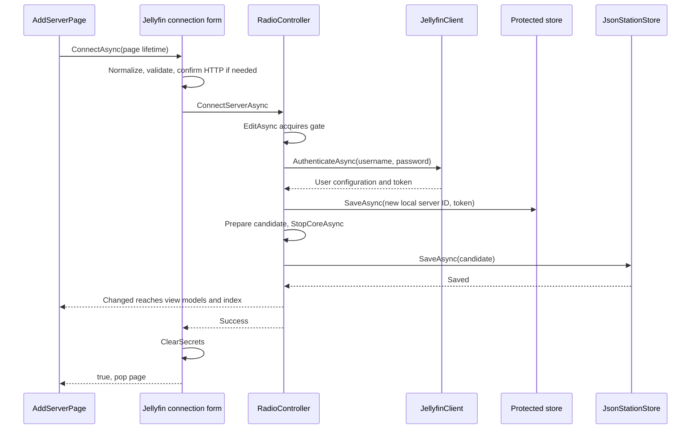

# Investigation: connect accounts, save stations, and import/export

[Overview](../overview.md) | [Configuration subsystem](../subsystems/configuration.md)

**Triggers:** Add server, Add/Save station, Import, or Export in MAUI.  
**Initial state:** RadioController has successfully loaded its lineup; Radio may be playing.  
**Evidence:** concrete call paths inspected; no real credentials or stored accounts were modified.

## Connect a Jellyfin account

| Step | Source and call | Data/state/result |
|---|---|---|
| 1 | [AddServerPage.cs](../../../src/JellyJam.MAUI/Views/AddServerPage.cs): SelectProvider -> IServerProvider.CreateForm | Resolves selected form; detaches/cancels prior form and clears secrets. |
| 2 | AddServerPage.ConnectAsync -> [JellyfinServerProvider.cs](../../../src/JellyJam.MAUI/Services/JellyfinServerProvider.cs): ConnectionForm.ConnectAsync | Validate server URL/username; ask explicit HTTP confirmation if needed. Page busy state prevents duplicate UI submits. |
| 3 | [RadioController.cs](../../../src/JellyJam.Core/Radio/RadioController.cs): ConnectServerAsync -> EditAsync | Normalize configuration, acquire edit gate, create temporary unauthenticated client. |
| 4 | [JellyfinClient.cs](../../../src/JellyJam.Core/Jellyfin/JellyfinClient.cs): AuthenticateAsync | SDK AuthenticateByName sends transient username/password; returns user/device/configuration plus access token. |
| 5 | RadioController.ConnectServerAsync | Create local RadioServer GUID, register credential compensation, await IServerCredentialStore.SaveAsync; return candidate lineup. |
| 6 | RadioController.EditAsync -> StopCoreAsync -> [JsonStationStore.cs](../../../src/JellyJam.Core/Configuration/JsonStationStore.cs): SaveAsync | Stop old tuner, save candidate, then publish in-memory lineup. Token and settings are separate writes. |
| 7 | RadioController.Changed | Index.Sync starts new provider scan; UI refreshes account choices. |
| 8 | ConnectionForm finally ClearSecrets; AddServerPage Navigation.PopAsync | Password cleared and page closed on successful connection. |

Connection/authentication, protected storage, or lineup save failure is mapped to a page error. Preparation failure precedes Stop; lineup-write failure can leave old settings but stopped Radio. Registered new credentials are deleted on failure, best effort.

## Save a source-specific station

[src/JellyJam.MAUI/ViewModels/StationsViewModel.cs](../../../src/JellyJam.MAUI/ViewModels/StationsViewModel.cs) -> `StationsViewModel.AddStationAsync()` is the command backing both add/edit form submission:

1. Parse frequency/call sign; request HTTP consent for an insecure direct/directory stream; build/validate source descriptor.
2. ValidateSourceAsync checks feed selection, internet selection, device permission/folder, server selection, and Plex libraries.
3. Construct RadioStation with stable editing ID or new GUID, kind/server ID, filters/effect, feeds, folder, libraries, and shuffle.
4. [RadioController.cs](../../../src/JellyJam.Core/Radio/RadioController.cs) -> `RadioController.SaveStationAsync()` normalizes call sign/feed URLs and calls RadioLineup.WithStation. Plex, Podcast, and Device may read source tracks before commit to reject unusable choices.
5. EditAsync stops Radio and saves/publishes. Existing station metadata cache is scheduled for clearing after commit; obsolete warmups are cancelled.
6. Changed refreshes UI; the form is cleared on success. Radio is not automatically restarted.

Duplicate/out-of-band frequency, missing source, denied permission, empty source, or I/O failure leaves the form's ErrorMessage. Post-commit cache cleanup failure does not undo the committed station.

## Plex variant

[PlexServerProvider.cs](../../../src/JellyJam.MAUI/Services/PlexServerProvider.cs) supplies its own multi-step form, rather than the page's single Add button. [PlexConnectionSession.cs](../../../src/JellyJam.Core/Plex/PlexConnectionSession.cs) proceeds StartAsync -> AuthorizeAsync -> PIN request/poll -> server discovery -> ChooseAsync/ConnectAsync -> commit callback to RadioController.ConnectPlexAsync.

The session owns attempt identity, cancellation, expiry, endpoint validation/HTTP consent, and commit state. An overtaken pre-commit attempt cannot publish a connection; once commit begins it runs to completion. Plex reconnect preserves a matching local machine/account identity and records prior credentials for compensation.

## Import and export

- [StationsViewModel.cs](../../../src/JellyJam.MAUI/ViewModels/StationsViewModel.cs): ExportDataAsync -> [DataTransfer.cs](../../../src/JellyJam.MAUI/Services/DataTransfer.cs): ExportAsync -> RadioLineup.ForExport -> JsonStationStore.WriteAsync -> FileSaver. Final file contains configuration metadata, no tokens; Plex remembered endpoint/HTTP consent are stripped. Cancellation returns false. It can still contain private names/URLs/folder metadata.
- ImportDataAsync -> DataTransfer.ImportAsync -> FilePicker -> JsonStationStore.ReadAsync -> collect Jellyfin login prompts and Plex authorizations -> **RadioController.ReplaceAsync**.
- ReplaceAsync creates replacement account-ID mappings, remaps station ServerId while preserving station identity, saves/publishes, then revokes/removes old credentials, clears affected track caches, and applies imported LastFrequency.
- Dismissing file selection or an authorization prompt returns false before replacement. Bad file or failed login raises an error. After-commit cleanup is best effort.

The separate RadioController.ImportAsync **merges**, including frequency collision replacement and possible account reuse. Its overwritten-Jellyfin-token rollback gap is review MIN-005; do not attribute that reproduced branch to DataTransfer's replacement call.

## Debugging and persistence checklist

Follow form -> command -> EditAsync -> candidate -> credential write -> StopCoreAsync -> lineup write -> publication -> cleanup. Inspect the local IDs at every boundary. Do not interpret Changed as commit success, or temporary-file replacement as a transaction across credentials and settings.

Tests to navigate: [RadioControllerTests.cs](../../../tests/JellyJam.Core.Tests/RadioControllerTests.cs), [PlexControllerTests.cs](../../../tests/JellyJam.Core.Tests/PlexControllerTests.cs), [StationFormTests.cs](../../../tests/JellyJam.MAUI.Tests/StationFormTests.cs). Runtime authentication and file-picker interaction remain unexecuted here.
