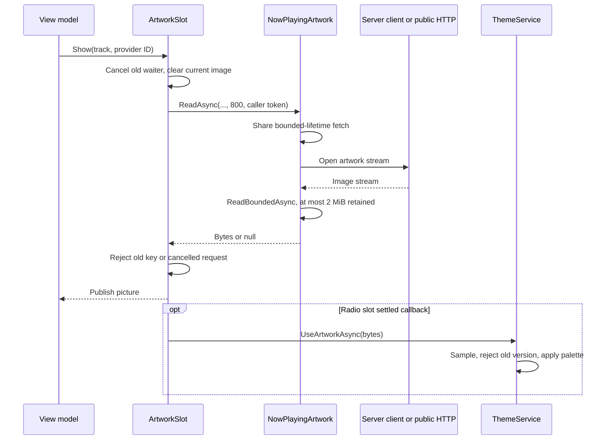

# Investigation: artwork, favorite toggle, and recently played

[Overview](../overview.md) | [Library](../subsystems/library.md) | [Presentation](../subsystems/presentation.md)

**Triggers:** new sounding track, image requested while browsing, heart/menu action, or a Library track reaching Playing.  
**Initial state:** provider/track metadata identifies artwork and/or a favorite entry.  
**Evidence:** inspected source; no remote artwork or native image decoder exercised.

## Current-track artwork chain

| Step | Source and call | Data/state/result |
|---|---|---|
| 1 | [RadioViewModel.cs](../../../src/JellyJam.MAUI/ViewModels/RadioViewModel.cs) / [LibraryViewModel.cs](../../../src/JellyJam.MAUI/ViewModels/LibraryViewModel.cs): snapshot Refresh -> ShowTrack/ShowNowTrack | Offer current Track and optional Jellyfin provider ID to ArtworkSlot. |
| 2 | [ArtworkSlot.cs](../../../src/JellyJam.MAUI/ViewModels/ArtworkSlot.cs): Show | Compute NowPlayingArtwork.KeyFor, cancel old waiter, clear displayed bytes, request only when picture identity changes. |
| 3 | ArtworkSlot.LoadAsync -> [NowPlayingArtwork.cs](../../../src/JellyJam.Core/Library/NowPlayingArtwork.cs): ReadAsync | Request 800-pixel artwork; share fetch task keyed by provider/album-or-track or public URL plus size. |
| 4 | NowPlayingArtwork.FetchAsync | Own 20-second total limit independent of any one caller. Choose authenticated server or credential-free public path. |
| 5a | ReadFromServerAsync -> [LibraryCatalog.cs](../../../src/JellyJam.Core/Library/LibraryCatalog.cs): GetClientAsync -> [JellyfinLibraryClient.cs](../../../src/JellyJam.Core/Jellyfin/JellyfinLibraryClient.cs): OpenArtworkAsync | Try album primary image, then track image; read body with byte bound. |
| 5b | ReadPublicAsync | Validate initial HTTPS/no-user-info address, make image HTTP request, check success/content type/declared size, then bounded stream read. Public HttpClient follows a limited number of redirects. |
| 6 | ArtworkSlot.LoadAsync | Ignore cancelled/stale key; publish bytes/null. Radio slot's settled callback offers final picture to ThemeService. |
| 7 | [ThemeService.cs](../../../src/JellyJam.MAUI/Services/ThemeService.cs): UseArtworkAsync -> PaletteOfAsync | Platform sampler -> ArtworkPalette; version check; apply colors only when AlbumArtwork palette is selected. |

The initial URL check is not a claim that every redirect/trust-boundary scenario was audited. Current-track fetch failure is decorative: null, not a playback stop.

## Browser artwork differs

Library node/shelf ImageSource loaders call [LibraryBrowser.cs](../../../src/JellyJam.Core/Library/LibraryBrowser.cs): ReadArtworkAsync(provider, node, size, token), resolve the client, then OpenArtworkAsync. This cache is keyed by provider/node/size and cleared when it reaches 300 entries.

It currently CopyToAsync's the entire stream into MemoryStream **before** checking a 2 MiB retained payload limit. Do not describe it as a bounded network read. Source read failures log a warning and return null; caller cancellation propagates. This is review MIN-004.

## Favorite and recent metadata chain

1. Heart action -> [LibraryViewModel.cs](../../../src/JellyJam.MAUI/ViewModels/LibraryViewModel.cs): ToggleNowFavorite -> [PlayerShell.cs](../../../src/JellyJam.Core/Playback/PlayerShell.cs): LocateNowPlaying.
2. LocateNowPlaying returns an active Library track/provider or a locked Jellyfin Radio track/provider. Device, Plex, podcast, and internet radio have no Library entry through this method.
3. VM wraps the track as a song node -> [LibraryShelves.cs](../../../src/JellyJam.Core/Library/LibraryShelves.cs): ToggleFavorite. Artist/album/song row menus also reach the shelf operation; genres cannot be favorited.
4. Shelves modifies its metadata list under lock, schedules Persist, then Changed updates heart/carousels on MainThread.
5. Persist's background task takes a write lock, snapshots the latest state, and calls [JsonLibraryShelfStore.cs](../../../src/JellyJam.Core/Configuration/JsonLibraryShelfStore.cs): Save -> temporary JSON -> replace library-shelves.json.
6. Independently, MauiProgram wires LibraryShelves.Attach to LibraryPlayer. A Playing snapshot calls RecordPlay, locates album (artist fallback), deduplicates/reorders, caps the global recent list at 20, and takes the same persistence path.

Final favorite state changes immediately in memory; persistence is deferred. No Jellyfin favorite endpoint is called. RecordPlay observes Library starts, not every Radio track. The lastRecorded guard compares track GUID, while shelf identity otherwise includes provider/type/node ID.

## Failure paths and debugging

Artwork requests can complete out of order; inspect slot key/token, shared fetch key, and theme version. Clearing the old image before a new result is expected. Shelf covers and current-track pictures use different loaders/cache policies.

Favorite/recent write IO/access errors warn; there is no flush API or task join on app close. A visible heart is not proof that the write has reached disk. Corrupt shelf JSON falls back to empty with diagnostics on relevant read exceptions.

Tests: [NowPlayingArtworkTests.cs](../../../tests/JellyJam.Core.Tests/NowPlayingArtworkTests.cs), [LibraryShelvesTests.cs](../../../tests/JellyJam.Core.Tests/LibraryShelvesTests.cs), [ArtworkPaletteTests.cs](../../../tests/JellyJam.Core.Tests/ArtworkPaletteTests.cs). Artwork byte checks and actual native image memory are different verification surfaces.
