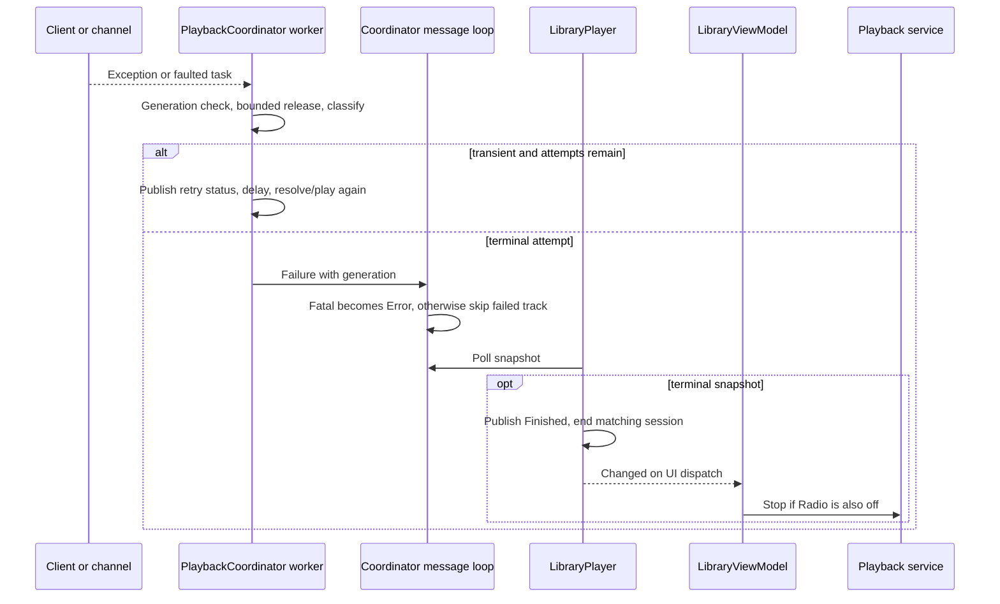

# Investigation: failure, interruption, and shutdown

[Overview](../overview.md) | [Platform lifecycle](../subsystems/platform-lifecycle.md)

**Triggers:** stream/network failure, channel completion fault, audio focus loss, headphone disconnect, notification action, or window destruction.  
**Initial state:** active or loading Radio/Library output.  
**Evidence:** source paths inspected; no native device-loss or close-time data-loss experiment performed here.

## Library failure chain

| Step | Source / operation | Result and state |
|---|---|---|
| 1 | [JellyfinClient.cs](../../../src/JellyJam.Core/Jellyfin/JellyfinClient.cs) ResolveAsync or [platform channels](../subsystems/audio.md) Ready/Completed faults | Error reaches coordinator RunTrackAsync through resolve or IAudioPlayer.PlayAsync. |
| 2 | [PlaybackCoordinator.cs](../../../src/JellyJam.Core/Playback/PlaybackCoordinator.cs): RunTrackAsync catch | Reject obsolete generation; release known source with two-second cleanup limit; classify using ErrorMessageMapper. |
| 3 | [ErrorMessageMapper.cs](../../../src/JellyJam.Core/ErrorMessageMapper.cs): IsTransient/IsAuthFailure/ToUserMessage | Retry transient failures within the attempt limit; map safe message and fatal flag. |
| 4 | Coordinator message -> HandleTrackEvent -> HandleFailure | Fatal -> cancel/Error. Nonfatal -> mark failed track, select next; exhausted candidates -> Error. |
| 5 | [LibraryPlayer.cs](../../../src/JellyJam.Core/Library/LibraryPlayer.cs): PollAsync -> EndIfCurrentAsync | Publish terminal state/Finished, acquire gate, end matching session, cancel/await run, dispose output. |
| 6 | [LibraryViewModel.cs](../../../src/JellyJam.MAUI/ViewModels/LibraryViewModel.cs): RefreshPlayback | Show state/message; stop service when Finished and Radio is not on. |

Natural completion is not this failure branch: it queues completion without Failure, permitting repeat/next semantics. Explicit cancellation should not be interpreted as natural track completion.

## Radio failure chain

[StationFeed.cs](../../../src/JellyJam.Core/Radio/StationFeed.cs) RunAsync/BroadcastAsync catches source/channel errors. Transient metadata/resolve operations have bounded retries; fatal errors fail the feed, finite nonfatal errors can skip, live errors reconnect within its consecutive-failure policy. Fail sets failure state and signals [RadioTuner.cs](../../../src/JellyJam.Core/Radio/RadioTuner.cs).

RadioTuner.Refresh observes failure, sets static instead of connecting tone for a locked failed station, publishes Failed snapshot, and keeps running. RadioController forwards Changed to UI/service. The user can retune away; this does not automatically power the whole Radio off.

## Native triggers are distinct

| Trigger | Actual source call path | Outcome / caveat |
|---|---|---|
| Permanent Android audio-focus loss | [AndroidRadioOutput.cs](../../../src/JellyJam.MAUI/Platforms/Android/AndroidRadioOutput.cs): OnAudioFocusChange -> Interrupted -> [MauiProgram.cs](../../../src/JellyJam.MAUI/MauiProgram.cs) output callback | SafeTask invokes the specific Radio or Library owner's StopAsync. |
| Temporary focus loss / duck | AndroidRadioOutput.SetFocusScale | Mixer volume becomes zero/0.2; streams continue. Focus gain restores scale; not cursor-preserving pause. |
| Becoming noisy/headphones disconnected | [RadioPlaybackService.cs](../../../src/JellyJam.MAUI/Platforms/Android/RadioPlaybackService.cs): NoisyReceiver.OnReceive | Starts SafeTask stops for **both** owners. |
| Ordinary notification Stop/Pause | RadioPlaybackService.HandleCommand or Controls.OnStop/OnPause | Stops **Radio only**; can leave Library active. Skip likewise jumps stations, metadata comes from Radio. |
| Android speaker write error | AndroidRadioOutput.Feed | Breaks feeder loop silently; does **not** raise Interrupted or fault a shared output contract. UI can stay active while PCM no longer drains. |
| Windows output-open error | [NAudioRadioOutput.cs](../../../src/JellyJam.Infrastructure.Windows/Audio/NAudioRadioOutput.cs): CreateOutput | Disposes failed player and throws a friendly device error to the caller. Later device-terminal propagation is not wired here. |

## Stop and destruction sequence

- **Radio Stop:** [RadioController.cs](../../../src/JellyJam.Core/Radio/RadioController.cs): StopAsync -> StopCoreAsync -> cancel lifetime -> await tuner run -> ReleaseRunningAsync -> dispose output/connections -> best-effort save LastFrequency. Tuner finally detaches feeds and awaits disposal tasks.
- **Library Stop:** LibraryPlayer.StopAsync -> EndSessionAsync -> cancel lifetime -> await coordinator run -> dispose output -> publish Stopped. Coordinator finally cancels current work and awaits its worker.
- **Decoder close:** [DecoderWorker.cs](../../../src/JellyJam.Core/Audio/DecoderWorker.cs): DisposeAsync -> cancel -> wait up to two seconds; blocked native cleanup can continue afterward on its worker.
- **Android output close:** AudioTrack stop/flush runs off caller thread; join feeder for two seconds, otherwise schedule later release after it exits; abandon focus.
- **Window destruction:** [App.cs](../../../src/JellyJam.MAUI/App.cs): CreateWindow Destroying handler -> SetForeground(false) -> playbackService.Stop -> await Radio.DisposeAsync.
- **Android service destruction:** unsubscribe both players; unless superseded, start asynchronous stops for both; release receiver/session and notification.

## Persistence, final outcome, and limits

Successful explicit stop normally releases the owner's audio and leaves a stopped/off snapshot; Radio's final dial save is best effort. Library stream release calls can notify the server. No playback cursor is saved by the active Library path.

There is no app-wide explicit sequence that joins Library/catalog/index jobs and flushes favorite writes. Windows playbackService.Stop is empty. LibraryIndex.Dispose cancels jobs without awaiting their completion; LibraryShelves has no flush. These are structural limits, not newly reproduced data loss.

SafeTask logs and suppresses errors that have no awaiting UI caller. Cache cleanup and some stream release failures are also suppressed. An absent log line is not proof that every cleanup step completed.

For debugging, distinguish **source failure**, **decoder failure**, **speaker failure**, **focus interruption**, and **requested stop** before changing retry logic. Relevant tests include [ErrorMessageMapperTests.cs](../../../tests/JellyJam.Core.Tests/ErrorMessageMapperTests.cs), [DecoderWorkerTests.cs](../../../tests/JellyJam.Core.Tests/DecoderWorkerTests.cs), and [PlaybackServiceLifetimeTests.cs](../../../tests/JellyJam.MAUI.Tests/PlaybackServiceLifetimeTests.cs). Real focus/device/destruction behavior remains a platform check.
