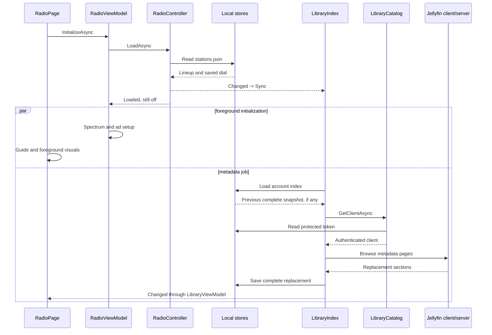

# Investigation: launch and restore saved state

[Overview](../overview.md) | [Canonical startup order](../startup.md)

**Trigger:** user launches the Android or Windows MAUI application.  
**Evidence:** source-traced; not a recorded device run.  
**Initial state:** a new container/process; saved JSON/preferences/tokens may exist. No active playback session is assumed.

## Call chain and state effects

The complete native/DI/UI order is maintained in [startup](../startup.md). This trace follows the restoration payload through that order.

| Step | Concrete source / invocation | Data, state, and side effects |
|---|---|---|
| 1 | [MainApplication.cs](../../../src/JellyJam.MAUI/Platforms/Android/MainApplication.cs) or [Windows App.xaml.cs](../../../src/JellyJam.MAUI/Platforms/Windows/App.xaml.cs): CreateMauiApp -> [MauiProgram.cs](../../../src/JellyJam.MAUI/MauiProgram.cs) | Register current-platform services; construct container; assign static Services; subscribe Radio.Changed to Index.Sync. |
| 2 | [App.cs](../../../src/JellyJam.MAUI/App.cs): constructor -> CreateWindow | Attach resource dictionary, resolve RadioPage, create NavigationPage/Window. No database setup. |
| 3 | [RadioViewModel.cs](../../../src/JellyJam.MAUI/ViewModels/RadioViewModel.cs): RestoreMode; [MauiProgram.cs](../../../src/JellyJam.MAUI/MauiProgram.cs): service factories | Preferences supply displayed mode, volume, provider, installation identity. They do not restore audio or track position. |
| 4 | [LibraryViewModel.cs](../../../src/JellyJam.MAUI/ViewModels/LibraryViewModel.cs): constructor; [LibraryShelves.cs](../../../src/JellyJam.Core/Library/LibraryShelves.cs): constructor | Browser is set to Now Playing; shelf store loads favorite/recent metadata. |
| 5 | [RadioPage.xaml.cs](../../../src/JellyJam.MAUI/Views/RadioPage.xaml.cs): OnAppearing -> ThemeService.InitializeAsync -> ShowRadioAsync | Await theme load through SafeTask, then VM initialization. |
| 6 | [RadioViewModel.cs](../../../src/JellyJam.MAUI/ViewModels/RadioViewModel.cs): InitializeAsync -> [RadioController.cs](../../../src/JellyJam.Core/Radio/RadioController.cs): LoadAsync | Await JsonStationStore.LoadAsync; restore LastFrequency; mark loaded; schedule podcast warmups. |
| 7 | [JsonStationStore.cs](../../../src/JellyJam.Core/Configuration/JsonStationStore.cs): LoadAsync -> ReadAsync -> Validate | Read stations.json; normalize old version and rebuild through lineup rules. No token in the returned RadioLineup. |
| 8 | RadioController.Changed -> [LibraryIndex.cs](../../../src/JellyJam.Core/Library/LibraryIndex.cs): Sync -> RunAsync | Begin account jobs off-thread; load saved complete metadata through JsonLibraryIndexStore. |
| 9 | [LibraryCatalog.cs](../../../src/JellyJam.Core/Library/LibraryCatalog.cs): GetClientAsync -> CreateAsync | Load account token from protected store; create JellyfinClient for the replacement scan. |
| 10 | LibraryIndex.ReadAllAsync -> [JellyfinLibraryClient.cs](../../../src/JellyJam.Core/Jellyfin/JellyfinLibraryClient.cs): BrowseAsync | Fetch four metadata sections in pages; save complete replacement, then publish snapshot/Ready. |
| 11 | Radio/Index Changed -> [RadioViewModel.cs](../../../src/JellyJam.MAUI/ViewModels/RadioViewModel.cs), [LibraryViewModel.cs](../../../src/JellyJam.MAUI/ViewModels/LibraryViewModel.cs) | Dispatch UI refresh to MainThread; index progress may continue after screen initialization. |
| 12 | RadioViewModel.RestoreSpectrumAsync/InitializeAdsAsync; RadioPage.ShowRadioAsync | Request visualizer enablement/permission, perform ad setup, show unseen guide, enable foreground decoration. |

## Restoration sequence

## Outcome, external calls, and persistence

The user gets initialized screens and any saved metadata, with background refresh potentially still running. No output is opened and no foreground playback service is required merely for this restoration. Network interactions can include Jellyfin metadata, podcast warmups/probes, and Android ad/consent setup.

Restoration reads authoritative settings and credentials, can write refreshed index/track metadata, and may write visualizer or installation preferences. Library history, the last replay request, navigation stack, audio buffers, and absolute playback cursor are not restored.

## Failure paths and debugging

- Missing stations.json -> empty lineup/setup state. Invalid/unreadable file -> blocking error; Load's Changed still fires. VM's one-time initialization flag prevents automatic repeat load on every appearance.
- Index/token/server failure -> Failed index status; saved snapshot remains usable. No snapshot means server fallback for supported browsing, but local search has no results until indexing succeeds.
- Theme failure -> reported default appearance, not blocked Radio.
- Ads failure handling is not proof of consent eligibility; see [platform lifecycle](../subsystems/platform-lifecycle.md).
- The selected mode may be Library while no audio is playing. This is expected.

Break at RadioController.LoadAsync, JsonStationStore.Validate, LibraryIndex.RunAsync, and each view model's Refresh. Inspect filenames/account identities without displaying token contents.
