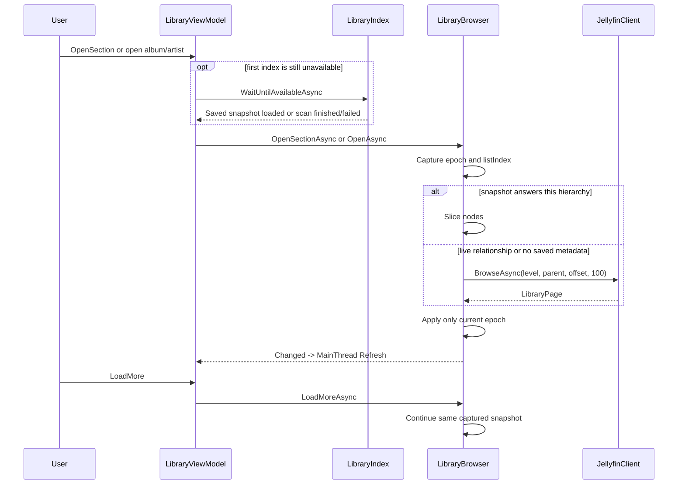

# Investigation: open a Library, browse an album, and search

[Overview](../overview.md) | [Library subsystem](../subsystems/library.md)

**Trigger:** account dropdown selection, section/artist/album tap, load-more, Back, or search input.  
**Initial state:** saved Jellyfin account available in the lineup; metadata scan may be running, complete, or failed. Radio or Library audio may continue independently.

## Browsing call chain

| Step | Source / operation | Data/state/events |
|---|---|---|
| 1 | [LibraryView.xaml](../../../src/JellyJam.MAUI/Views/LibraryView.xaml) command -> [LibraryViewModel.cs](../../../src/JellyJam.MAUI/ViewModels/LibraryViewModel.cs): OpenProvider | Close menus and call Browser.OpenProvider(provider.Id). |
| 2 | [LibraryBrowser.cs](../../../src/JellyJam.Core/Library/LibraryBrowser.cs): OpenProvider | Retry failed index, cancel old navigation, clear history, validate provider, remember selected ID, publish sections state. |
| 3 | LibraryViewModel.OpenSection or OpenAsync | ExecuteAsync sets busy/error state, then WaitForIndexAsync waits only if indexing and no saved snapshot. CancelIndexWait cancels the waiter. |
| 4 | Browser.OpenSectionAsync/OpenAsync -> Navigate | Determine section/parent/trail, capture provider and current index, increment epoch, cancel prior load, publish IsLoading. |
| 5 | Browser.LoadAsync -> ReadPageAsync | Use captured snapshot where possible; artist-parent children or missing index query the live client. |
| 6 | [LibraryCatalog.cs](../../../src/JellyJam.Core/Library/LibraryCatalog.cs): GetClientAsync -> [JellyfinLibraryClient.cs](../../../src/JellyJam.Core/Jellyfin/JellyfinLibraryClient.cs): BrowseAsync | Reuse authenticated account client, pass level/parent/start/count=100, map SDK metadata to LibraryPage. |
| 7 | Browser.Apply | Reject obsolete epoch; replace or append deduplicated nodes, set HasMore/IsLoading/message. If Now Playing is shown, update its saved return state instead. |
| 8 | Browser.Changed -> LibraryViewModel.Refresh | MainThread projects rows, breadcrumbs, home shelves, and controls. |

Album/artist navigation does not start playback. Song OpenNode delegates to PlayNode instead; that continuation is in [Library playback](library-playback.md). Back prefers album -> artist -> sections, otherwise history; Now Playing returns to its saved browse state.

## Search continuation

1. LibraryViewModel.OpenSearch/OpenProviderSearch chooses provider and calls [LibrarySearchViewModel.cs](../../../src/JellyJam.MAUI/ViewModels/LibrarySearchViewModel.cs): Open.
2. OnQueryChanged cancels/disposes the old query token. Empty text clears results; nonempty text schedules SearchAsync.
3. After 150 ms, SearchAsync reads catalog.Index.Snapshot and runs [LibrarySearch.cs](../../../src/JellyJam.Core/Library/LibrarySearch.cs): Find off-thread.
4. Find inspects artist/album/song metadata, compares case/accent-insensitively, ranks matches, checks cancellation periodically, and returns up to 20 nodes.
5. SearchAsync rejects cancellation before replacing Results and Message.
6. Choose closes the box, then LibraryViewModel.OpenSearchResultAsync -> OpenEntryAsync. Artist/album -> ShowEntryAsync -> Browser.ShowAsync. Song -> PlaySearchedSong, using indexed album context when available, then shell playback and Now Playing.

Search itself makes no remote search request and no persistence write. Choosing a result can lead to authenticated browse/stream requests. Selected-provider preference is written by browser provider/show navigation, not by text matching.

## Failure paths, outcomes, and investigation

No provider produces an explicit connect-account message. Missing account during navigation produces a stale-provider message. Failed index with old snapshot keeps local lists/search usable; without an index, search reports that indexing is required. Browsing errors become State.Message and clear IsLoading; cancelled/overtaken navigation does not publish stale nodes.

Final browse outcome is a current provider/list/history with no playback mutation. Final search outcome is ranked local nodes or an explanatory message; selection then follows either browse or playback.

Inspect provider ID, index Progress/HasSnapshot, browser epoch/listIndex/Trail, and cancellation before investigating XAML. [LibraryBrowserTests.cs](../../../tests/JellyJam.Core.Tests/LibraryBrowserTests.cs) and [LibrarySearchTests.cs](../../../tests/JellyJam.Core.Tests/LibrarySearchTests.cs) are direct test anchors. Remote hierarchy and visual dropdown behavior were not executed here.
