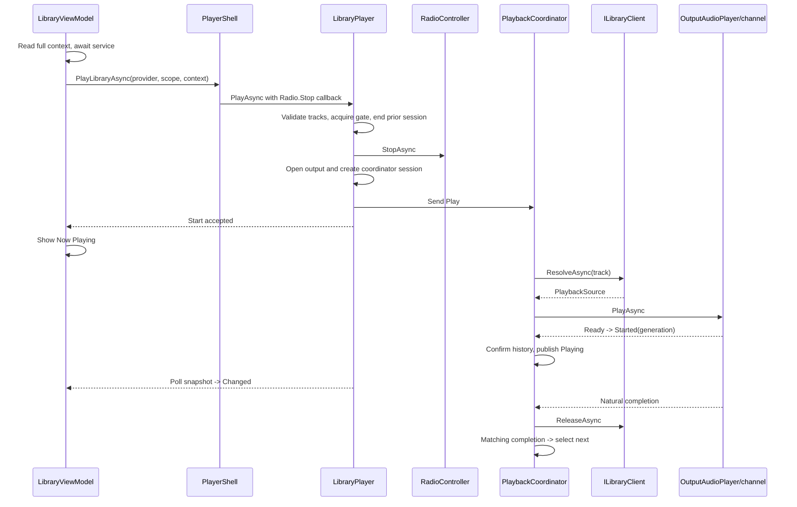

# Investigation: selected playback, transport, and owner switching

[Overview](../overview.md) | [Playback internals](../subsystems/playback.md)

**Trigger:** tap a song/Play scope/Play account, or use Next/Previous/Stop/Play.  
**Initial state:** a valid provider and selection context; Radio or another Library selection may be playing.  
**Evidence:** source-traced asynchronous path, not a live audio run.

## Start a selected track

| Step | Concrete call chain | Payload/state/side effects |
|---|---|---|
| 1 | [LibraryViewModel.cs](../../../src/JellyJam.MAUI/ViewModels/LibraryViewModel.cs): OpenNode -> PlayNode -> PlayAsync | Capture provider, song node, current browse state; wait for available index if necessary. |
| 2 | [LibraryBrowser.cs](../../../src/JellyJam.Core/Library/LibraryBrowser.cs): ReadListTracksAsync | If more pages remain, read full indexed/remote scope so playback is not restricted to visible rows. |
| 3 | LibraryViewModel.StartPlaybackAsync | Request notification permission where applicable; await IPlaybackServiceController.EnsureStartedAsync. |
| 4 | [PlayerShell.cs](../../../src/JellyJam.Core/Playback/PlayerShell.cs): PlayLibraryAsync -> [LibraryPlayer.cs](../../../src/JellyJam.Core/Library/LibraryPlayer.cs): PlayAsync/ReadAsync | Resolve ILibraryClient, obtain context/index/remote scope tracks, deduplicate, ensure nonempty, include chosen song if absent. |
| 5 | LibraryPlayer gate -> EndSessionAsync -> beforeStart | End old Library session; callback awaits RadioController.StopAsync only after valid selection exists. |
| 6 | LibraryPlayer.Open -> coordinator/session construction | Create output with shared volume, no static/tone; selected song becomes ResumePoint at zero; send Play and start polling. |
| 7 | [PlaybackCoordinator.cs](../../../src/JellyJam.Core/Playback/PlaybackCoordinator.cs): Handle(Play) -> TrackSelector.Begin/Next -> Start | Publish Loading, increment generation/cancel old load, chain RunTrackAsync behind prior worker. |
| 8 | Coordinator.ResolveAsync -> [JellyfinClient.cs](../../../src/JellyJam.Core/Jellyfin/JellyfinClient.cs): ResolveAsync | PlaybackInfo -> PlaybackSource with provider transport/session; stream fetching happens downstream. |
| 9 | [OutputAudioPlayer.cs](../../../src/JellyJam.Core/Playback/OutputAudioPlayer.cs): PlayAsync | Open channel, gain=1, await Ready, call onStarted, await Completed. |
| 10 | Coordinator Started message -> HandleTrackEvent | Match generation, confirm selector history, publish Playing, prefetch next metadata/stream descriptor when applicable. |
| 11 | LibraryPlayer.PollAsync -> Publish -> Changed | UI shows current track/transport; shelves record start; Android service refreshes lifetime (but still Radio metadata). |
| 12 | LibraryViewModel returns from start -> Browser.ShowNowPlaying | Dedicated player view appears; PlayAsync return does not mean the track has finished loading or playing. |

## Transport and actual sequence behavior

- **Next:** LibraryViewModel.Next checks ControlsRadio. If true, jump station; otherwise LibraryPlayer.Next -> coordinator Send(Next) -> discard pending selection -> selector.Next -> Start.
- **Previous:** same owner check; Library path discards a pending load before falling back to confirmed history. It is not a seek-to-zero command.
- **Natural completion:** audio task finishes, source is released, matching-generation completion reaches HandleTrackEvent -> selector.Next(naturalCompletion: true). Song repeat applies here; explicit Next bypasses it.
- **Shuffle/repeat:** view model -> LibraryPlayer.SetModesAsync under its gate -> coordinator mode message with completion acknowledgement; running changes have a five-second timeout. Choices remain in the singleton, not a restored persisted Library session.
- **Stop:** view model stops the sounding owner and service as appropriate. Library.StopAsync cancels/awaits the coordinator, disposes output, and publishes Stopped at zero.
- **Play after Stop:** PlayerShell.ReplayLibraryAsync reuses the last in-memory provider/scope/context request and starts from its beginning. No genuine pause/resume position is retained.
- **Seek/queue editing:** no exposed action in PlayerAction or this UI path. A start offset in PlaybackSource is an internal capability, not evidence of a seek feature.

## View switching versus audio ownership

RadioViewModel.SelectMode -> preference write -> PlayerShell.SetMode changes the displayed mode only. It does not stop, retune, or create a session.

Starting Radio through the app goes PlayerShell.StartRadioAsync -> Library.StopAsync -> Radio.StartAsync. Starting Library uses the beforeStart callback above. Radio.Changed has a best-effort stop-if-both-active handler, but there is no global transition gate.

The review's controlled interleaving starts Radio directly while Library is between stopping Radio and publishing its session. Both can then remain active. Platform commands are a real direct Radio entry point, so this is not safely dismissed as a UI busy-button issue.

## Persistence, failure, and final outcome

Playback makes authenticated resolve/release calls but does not persist audio, selected sequence, or track cursor. Shelves may write recent metadata; stopping Radio during handoff best-effort writes its dial. Changing displayed mode writes only a preference.

Invalid/empty selection fails before stopping old playback. Output creation or later stream failure happens after the handoff and may leave no audible owner. Transient failures retry boundedly; nonfatal track failures skip; fatal/no-playable remainder publishes Error. Obsolete generation events cannot advance the current sequence. Finished terminal snapshots release the session and can stop the service through the UI refresh path.

Inspect the **actual owner**, not selected mode; then session identity, coordinator generation, selector pending/history, and channel tasks. See [PlayerShellTests.cs](../../../tests/JellyJam.Core.Tests/PlayerShellTests.cs), [LibraryPlayerTests.cs](../../../tests/JellyJam.Core.Tests/LibraryPlayerTests.cs), and [PlaybackCoordinatorTests.cs](../../../tests/JellyJam.Core.Tests/PlaybackCoordinatorTests.cs).
