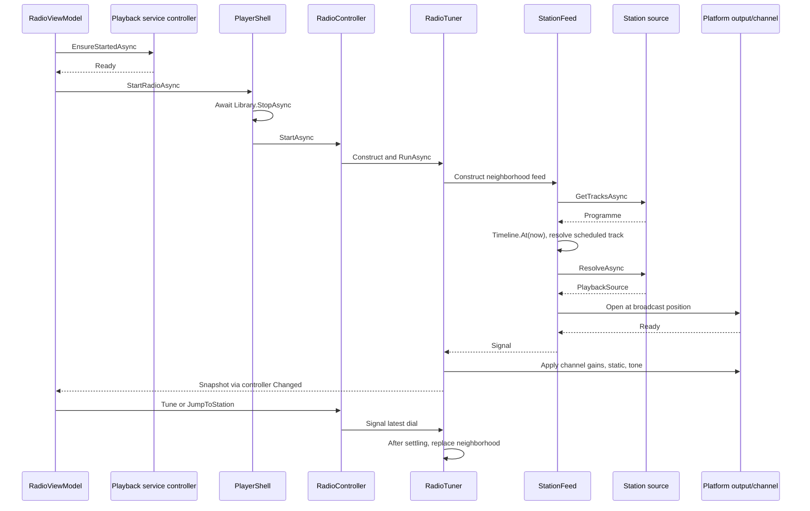

# Investigation: power Radio on, tune, and change source

[Overview](../overview.md) | [Radio internals](../subsystems/radio.md) | [Audio internals](../subsystems/audio.md)

**Trigger:** power button, dial movement, or station jump in MAUI.  
**Initial state:** loaded lineup; one or more configured stations; possibly a playing Library session.  
**Evidence:** source-traced finite Jellyfin path, with live/local variants identified.

## Full path

| Step | Concrete source / operation | Data, state, external effects |
|---|---|---|
| 1 | [RadioViewModel.cs](../../../src/JellyJam.MAUI/ViewModels/RadioViewModel.cs): TogglePowerAsync -> ExecuteAsync | If already on: stop Radio/service. Otherwise set Starting and request Android notification permission where applicable. |
| 2 | [AndroidPlaybackServiceController.cs](../../../src/JellyJam.MAUI/Platforms/Android/AndroidPlaybackServiceController.cs): EnsureStartedAsync | Await foreground-service handshake; Windows implementation is a no-op. |
| 3 | [PlayerShell.cs](../../../src/JellyJam.Core/Playback/PlayerShell.cs): StartRadioAsync | Await Library.StopAsync, then Radio.StartAsync. |
| 4 | [RadioController.cs](../../../src/JellyJam.Core/Radio/RadioController.cs): StartAsync | Gate/loaded checks; create ServerConnections, Plex source, output, lifetime, and RadioTuner from current lineup and dial. |
| 5 | [RadioTuner.cs](../../../src/JellyJam.Core/Radio/RadioTuner.cs): RunAsync -> Refresh -> SyncFeeds | Start run-once signal loop, compute neighborhood, construct StationFeeds. |
| 6 | [StationFeed.cs](../../../src/JellyJam.Core/Radio/StationFeed.cs): RunAsync -> StartProgrammeAsync | Read cached programme or source; attach an initial refresh or await podcast warmup if applicable. |
| 7 | [StationSources.cs](../../../src/JellyJam.Core/Radio/StationSources.cs): GetTracksAsync -> [ServerConnections.cs](../../../src/JellyJam.Core/Radio/ServerConnections.cs): GetTracksAsync | For Jellyfin, load token/create shared client; read cached five-minute filtered list or page remote metadata. |
| 8 | StationFeed.LoadAsync -> [RadioTimeline.cs](../../../src/JellyJam.Core/Radio/RadioTimeline.cs): At | Keep timed distinct tracks; map now/station identity/shuffle to track and start/end times. |
| 9 | StationFeed.AirAsync -> TakeAsync/ResolveWithRetryAsync -> source.ResolveAsync -> [JellyfinClient.cs](../../../src/JellyJam.Core/Jellyfin/JellyfinClient.cs): ResolveAsync | Obtain PlaybackInfo and short-lived PlaybackSource, possibly using prefetched transport. |
| 10 | StationFeed.StartPosition/PrepareReadAhead/PlayAsync -> output.Open | Apply clock-relative position and station effect; prepare provider MP3 reserve when supported; open native channel and attach track. |
| 11 | Channel.Ready -> StationFeed.SetReady -> tuner signal -> TuningMix.At | Ready feed can receive gain; tuner publishes Playing/Connecting/Failed/None snapshot with static/tone decisions. |
| 12 | RadioTuner.Changed -> RadioController.Changed -> RadioViewModel.Refresh | MainThread projects call sign/title/artist/frequency and artwork. Service also refreshes notification. |
| 13 | StationFeed.WaitForEndAsync -> dispose channel -> ReleaseAsync | At completion/rejoin, release remote session and continue scheduled/live loop. |

## Sequence

## Changing sources and outcomes

Dial movement reaches RadioController.Tune through RadioViewModel.OnFrequencyChanged; JumpToStation goes directly to the controller. The tuner coalesces updates and waits 300 ms before opening newly encountered neighbors. Existing feeds can remain warm; old neighborhood feeds are disposed. This is source switching through the dial, not a global provider swap or queue edit.

Finite Jellyfin/Plex/Podcast/Device sources share the timeline. Internet branches to StationFeed.BroadcastAsync -> ListenAsync -> WaitForLiveEndAsync: one endless source reconnects, with no RadioTimeline call.

Final successful state is Radio on, with an appropriate RadioSnapshot and output receiving gain-scaled samples. Between stations it may intentionally be static; connecting and failed stations are distinct. IsOn alone does not prove audible playback.

## Persistence and failure paths

Starting/tuning does not persist each intermediate dial movement. Radio Stop best-effort saves LastFrequency; programme reads/refreshes can write track-list/duration caches. Remote Resolve/Release can create/end Jellyfin/Plex stream sessions. No audio is persisted.

- Empty/invalid lineup or output creation failure aborts start; VM stops the service on start failure.
- Invalid/untimed source data fails a feed. Transient load/resolve errors retry boundedly; fatal auth errors do not retry indefinitely.
- A failed finite track can advance early; failed station ultimately becomes static while the tuner remains responsive.
- Live failure reconnects with its own bounded consecutive-failure policy; healthy reception resets its counter.
- A device-output write failure may not reach the owner; see [error trace](errors-and-lifecycle.md).
- Direct platform Radio starts can race with Library handoff; see [Library playback](library-playback.md).

Debug in order: displayed mode -> actual owner -> frequency/neighborhood -> source metadata -> timeline -> transport -> Ready -> gain -> mixer -> speaker. This avoids treating intentional static or a warm silent channel as a decoder defect.
