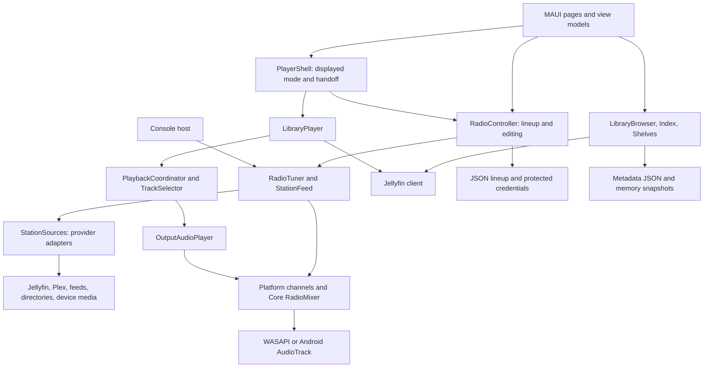

# JellyJam architecture knowledge base

## Scope and evidence

Source baseline: **2026-11-15**, HEAD `59cfe4c2c415467551046315dc5e05329ef353d4`, including the existing local Android playback-service lifetime changes. This knowledge base describes the inspected worktree, not a proposed redesign.

The supplied [architecture review](../../.github/generated/architecture-review.md) is the assessment and remediation register. This directory is the operational companion: responsibilities, call paths, state, and code navigation. Review recommendations are **not** implemented features. Existing application code, tests, and the review were not changed to produce these documents.

- **Confirmed:** supported by source inspection; not a claim that the path ran on a device.
- **Inferred:** an interpretation of a design choice, explicitly labeled in the [decision register](decisions/architecture-decisions.md).
- **Verification gap:** native behavior, live integrations, rendering, or internals not exercised here.

## Start here

| Question | Document |
|---|---|
| What composes what? | [Dependency graph](dependency-graph.md) |
| What happens before the screen appears? | [Startup](startup.md) |
| Who owns and persists each value? | [Data flow and state](data-flow.md) |
| Where should I put a breakpoint? | [Debugging guide](debugging-guide.md) |
| How do I add a feature using today's code? | [Feature development](feature-development.md) |
| What do the names mean? | [Glossary](glossary.md) |
| Which choices are deliberate or merely apparent? | [Architecture decisions](decisions/architecture-decisions.md) |

## Product and actual capabilities

JellyJam is a local, radio-style music application. Its maintained presentation is a shared MAUI application for **Android and Windows**. A separate Windows terminal host remains in the repository.

Radio assigns sources to virtual FM frequencies. Tuning joins a scheduled track partway through, or joins an actual live stream. Reception blends nearby stations with static and a connecting tone. Stations support Jellyfin, Plex, podcast feeds, device music, and public internet streams, with source-dependent filters and effects.

MAUI also has a **Jellyfin Library browser**: providers/accounts, artists, albums, genres, songs, local indexed search, selected-track playback, shuffle/repeat, favorites, recent albums, and artwork. Plex music-library selection in the station editor is not Plex Library-mode browsing.

There is no exposed editable playback queue, audio download/offline library, user seek command, or genuine pause/resume transport in the inspected active paths. (Playlists now exist as a lightweight, device-global list in `PlaylistLibrary`; they feed the Library engine, not the Radio.) The transport's stop/play behavior starts a stopped selection again; Radio rejoins its clock-based broadcast. See [Library playback](investigations/library-playback.md).

## Technology and repository structure

| Area | Current source |
|---|---|
| SDK/build | [.NET SDK configuration](../../global.json) requests 10.0.113 with latest-patch roll-forward. [Build properties](../../Directory.Build.props) enable nullable, implicit usings, latest analysis, and optional repository-local Android/JDK paths. |
| Core | [JellyJam.Core.csproj](../../src/JellyJam.Core/JellyJam.Core.csproj): `net10.0`, Jellyfin.Sdk 2026.10.12. Models, domain algorithms, orchestration, HTTP integrations, and JSON stores share one assembly. |
| Windows infrastructure | [JellyJam.Infrastructure.Windows.csproj](../../src/JellyJam.Infrastructure.Windows/JellyJam.Infrastructure.Windows.csproj): `net10.0-windows`, NAudio 3.3.0, ProtectedData 10.0.13. |
| MAUI | [JellyJam.MAUI.csproj](../../src/JellyJam.MAUI/JellyJam.MAUI.csproj): `net10.0-android` and `net10.0-windows10.0.19041.0`; root namespace `JellyJam.Mobile`; MAUI Controls 10.0.120, CommunityToolkit.Mvvm 8.4.2, CommunityToolkit.Maui 13.0.0. |
| Platform packages | Android ads/UMP and AndroidX bindings; Windows TagLibSharp 2.3.0 for local metadata. Conditional references are in the MAUI project. |
| Terminal host | [JellyJam.Console.csproj](../../src/JellyJam.Console/JellyJam.Console.csproj): Windows, Cocona 2.2.0 and Spectre.Console 0.57.2; namespace `JellyJam.Cli`. |
| Tests | [tests](../../tests): Core, Windows infrastructure, MAUI linked-source tests, Windows/Android integration and E2E, plus shared TestSupport. Twelve project files total: four production and eight test/support. |
| Delivery | [publish.ps1](../../publish.ps1): Android ARM64 APK and unpackaged self-contained Windows x64. Uses the repository-local .NET executable. |

[JellyJam.slnx](../../JellyJam.slnx) does **not** build MAUI or MAUI.Tests. [JellyJam.MAUI.slnx](../../JellyJam.MAUI.slnx) includes Core, MAUI, and MAUI.Tests. A green main-solution build is not a MAUI build.

## Architectural style

This is a single-process application per host, organized around platform-neutral contracts and constructor injection. It uses MVVM on MAUI, immutable-style snapshots for presentation, pure selection/timeline algorithms, and platform audio adapters. Core is platform-neutral, **not domain-only**: it contains filesystem and HTTP implementations.

There are two current orchestration engines:

1. Radio: controller -> tuner -> station feeds -> platform channels.
2. Library: library player -> playback coordinator -> single-track output adapter -> platform channels.

They share adapter implementations, not one singleton audio device or one command loop. The shell coordinates handoffs with ordered calls; its one-owner rule is not atomic across every entry point.

Arrows show responsibility/call direction, not separate deployed services. See the [dependency graph](dependency-graph.md) for compile-time and construction relationships.

## Subsystem map

| Subsystem | Responsibility and starting document |
|---|---|
| Station radio | [Radio](subsystems/radio.md): lineup facade, dial, clock schedule, feeds, reception. |
| Library | [Library](subsystems/library.md): providers, index, hierarchy, search, shelves, covers. |
| Selected playback | [Playback](subsystems/playback.md): shell handoffs, session, sequence/history, stop/next/previous. |
| Audio | [Audio](subsystems/audio.md): compressed transport, decoding, buffering, mixing, device output. |
| Source integrations | [Sources](subsystems/sources.md): Jellyfin/Plex/public/local track and stream adapters. |
| Persistence/accounts | [Configuration](subsystems/configuration.md): validation, credential separation, edit/import commit behavior. |
| Presentation | [Presentation](subsystems/presentation.md): commands, navigation, themes, artwork, terminal rendering. |
| Native host behavior | [Platform lifecycle](subsystems/platform-lifecycle.md): background service, focus, windows, ads, diagnostics. |

## End-to-end investigations

- [Launch and restoration](investigations/launch-and-restore.md)
- [Connect an account, edit a station, import/export](investigations/accounts-and-stations.md)
- [Start Radio and tune](investigations/radio-tuning.md)
- [Browse and search a Library](investigations/library-browse-search.md)
- [Play, change, stop, and switch owners](investigations/library-playback.md)
- [Artwork, favorites, and recent albums](investigations/artwork-and-shelves.md)
- [Failure, interruption, and shutdown](investigations/errors-and-lifecycle.md)

## Known discrepancies and investigation limits

The [review](../../.github/generated/architecture-review.md) owns finding severity and proposed fixes. Relevant current behavior is also called out at the affected subsystem:

- Android lifetime tracks both owners, but ordinary notification commands/metadata still target Radio.
- Speaker-output failure has no common terminal signal to Core.
- Shutdown is not an explicit join/flush sequence for all services.
- Browser artwork checks its byte limit after copying the body.
- Merge-import credential compensation differs from replacement import.
- The [README](../../README.md) still contains older CLI/coordinator and platform descriptions. It also mentions an 824-wide Windows layout; [DesktopLayoutMetrics.cs](../../src/JellyJam.MAUI/Services/DesktopLayoutMetrics.cs) currently caps width at **412 logical pixels**.
- [AppLaunchTests.cs](../../tests/JellyJam.E2E.Windows.Tests/AppLaunchTests.cs) still expects an 824-wide maximum. That is a source/test discrepancy, not a passing claim.
- [LibraryViewModel.cs](../../src/JellyJam.MAUI/ViewModels/LibraryViewModel.cs) calls `browser.ShowNowPlaying()` during construction; it does not initially leave the browser on the provider grid.

Investigation covered composition roots, principal models/contracts, both playback paths, browsing/indexing/search, edit/import persistence, provider orchestration, audio adapter boundaries, and native lifecycle code. It did not exhaustively inspect every drawing algorithm, parser, MP3 recovery algorithm, SDK implementation, or platform decoder branch. No live accounts, audio devices, ads/consent forms, emulator, or published app were exercised for this documentation task. Build/test commands below are maintainer instructions, not fresh test results.

Documentation validation checks local links and explicit source-symbol references and renders Mermaid diagrams. Such checks do not prove native behavior or historical design intent. Preserve these distinctions when updating the knowledge base.

### Validation record

On 2026-11-15, all **23 documents**, **577 local links**, and their Markdown heading targets were checked. Explicit source-symbol references and 116 qualified type/member pairs were checked against the current source; ILibraryClient's inherited ResolveAsync was verified through ITrackStreams. All **23 Mermaid diagrams rendered successfully** with Mermaid CLI 11.12.0 after syntax corrections. The documentation was also checked for required subsystem/trace coverage and inconsistent startup, ownership, persistence, and platform claims.

No application build, application test suite, live service call, or device run was performed for this documentation-only change.
