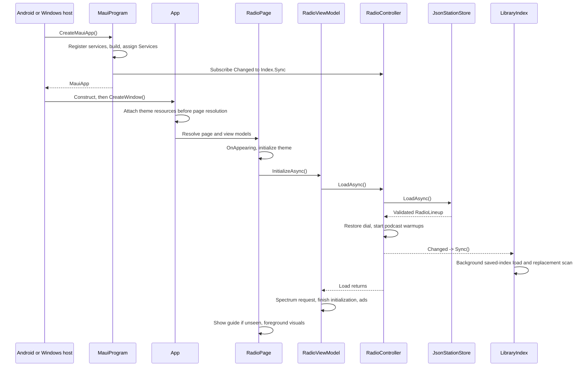

# Application initialization

[Overview](overview.md) | [Launch investigation](investigations/launch-and-restore.md)

## Native entry points

- Android: [src/JellyJam.MAUI/Platforms/Android/MainApplication.cs](../../src/JellyJam.MAUI/Platforms/Android/MainApplication.cs) -> `MainApplication.CreateMauiApp()` delegates to the shared root. [MainActivity.cs](../../src/JellyJam.MAUI/Platforms/Android/MainActivity.cs) is the launcher activity and document-tree picker callback owner.
- Windows: [src/JellyJam.MAUI/Platforms/Windows/App.xaml.cs](../../src/JellyJam.MAUI/Platforms/Windows/App.xaml.cs) -> `App.CreateMauiApp()` does the same through MauiWinUIApplication.
- CLI: top-level [src/JellyJam.Console/Program.cs](../../src/JellyJam.Console/Program.cs) builds a separate Cocona host.

## MAUI ordered initialization

Rows follow entry into the call chain; nested work completes before the caller resumes (for example, steps 7-9 are part of page resolution in step 6).

| Order | Source and operation | Effect / failure point |
|---|---|---|
| 1 | [MauiProgram.cs](../../src/JellyJam.MAUI/MauiProgram.cs) -> `MauiProgram.CreateMauiApp()` | Configure MAUI/Toolkit, fonts, and native Entry chrome. Register JSON theme/lineup stores using FileSystem.AppDataDirectory. |
| 2 | Same method, conditional registrations | Select credentials, local source, probe, folder picker, artwork, spectrum, playback-service controller, and ads implementation. Windows additionally configures window creation and logging. |
| 3 | Same method, singleton factories | Configure RadioController, source clients/caches, Library services, PlayerShell, Plex services, providers, and view models. Output factories are registered indirectly; no speaker is opened here. |
| 4 | `builder.Build()`, assign static Services | Resolve RadioController and LibraryCatalog.Index to subscribe Changed -> Sync. On Windows start TraceLoggerBridge. DI errors surface here or when a later service is first resolved. |
| 5 | [App.cs](../../src/JellyJam.MAUI/App.cs), constructor | Initialize resources, merge base Styles, attach ThemeService, force dark app theme. |
| 6 | [App.cs](../../src/JellyJam.MAUI/App.cs) -> `App.CreateWindow()` | Begin resolving RadioPage **after** theme resources exist; after steps 7-9, wrap it in NavigationPage/Window and hook lifecycle events. |
| 7 | [RadioViewModel.cs](../../src/JellyJam.MAUI/ViewModels/RadioViewModel.cs), constructor | Resolve this page constructor dependency first; restore `player.mode` and subscribe to model events. Its setting changes displayed mode only. |
| 8 | [RadioPage.xaml.cs](../../src/JellyJam.MAUI/Views/RadioPage.xaml.cs), constructor | Bind RadioViewModel; resolve LibraryViewModel and StationsView; connect artwork/spectrum/background, settings overlay, guide, and Windows layout. |
| 9 | [LibraryViewModel.cs](../../src/JellyJam.MAUI/ViewModels/LibraryViewModel.cs), constructor | Build home/search projection and subscriptions; explicitly call Browser.ShowNowPlaying. This differs from prose claiming the provider grid always opens first. |
| 10 | [RadioPage.xaml.cs](../../src/JellyJam.MAUI/Views/RadioPage.xaml.cs) -> `RadioPage.OnAppearing()` | Subscribe theme changes, await safe theme initialization, then ShowRadioAsync. |
| 11 | [RadioViewModel.cs](../../src/JellyJam.MAUI/ViewModels/RadioViewModel.cs) -> `RadioViewModel.InitializeAsync()` | Once per VM, run RadioController.LoadAsync and restore/request spectrum; mark initialization finished; initialize ads/consent as best effort. |
| 12 | [RadioController.cs](../../src/JellyJam.Core/Radio/RadioController.cs) -> `RadioController.LoadAsync()` | Load/validate lineup, set dial from LastFrequency, enable edits/start, schedule podcast cache warmups; Changed fires in finally, including on load failure. |
| 13 | [LibraryIndex.cs](../../src/JellyJam.Core/Library/LibraryIndex.cs) -> `LibraryIndex.Sync()` | Start one background job per saved Jellyfin account. Load last complete metadata, then scan and persist replacement. Startup does not wait for scans to finish. |
| 14 | RadioPage.ShowRadioAsync | Apply appearance, show first-run guide if unseen, enable foreground decoration. |

Singletons are resolved lazily: registration order is not a list of constructor invocation times. In particular, the LibraryPlayer is constructed before a session exists, and IRadioAudioOutput is created only when playback starts.

## What does not start automatically?

No database, ORM migration, hosted web server, or broker initialization exists in this composition. Persistent state is local JSON, protected tokens, and MAUI preferences.

No tuner, Library playback session, decoder channel, or Android foreground playback service is started merely by loading the lineup. The Android foreground service is awaited by the relevant Play command before output creation. External metadata work **can** start: podcast warmups and Library indexing need network access independently of audio.

## Ordering requirements and failures

- Resource dictionaries precede RadioPage XAML resolution; constructor-injecting that page into App would change this order.
- `RadioController.loaded` is false during load. Missing lineup file yields an empty lineup; malformed/unreadable authoritative data raises a user-facing error and blocks editing/start rather than overwriting it.
- RadioViewModel sets its one-time `initialized` flag before the load attempt. A failed first load is not automatically retried by every OnAppearing call.
- Index failure leaves a prior snapshot readable. First-index waiting can be cancelled by the user without cancelling the global scan.
- Theme-file failure is reported and falls back to the default. Ads are isolated from lineup loading, but the current consent failure behavior is documented in [platform lifecycle](subsystems/platform-lifecycle.md), not endorsed as a safe authorization policy.
- Spectrum startup requests enablement rather than reading the saved boolean; Android may ask for microphone permission for the native playback visualizer.
- Windows applies actual native size limits in [PhoneWindow.cs](../../src/JellyJam.MAUI/Platforms/Windows/PhoneWindow.cs) using [DesktopLayoutMetrics.cs](../../src/JellyJam.MAUI/Services/DesktopLayoutMetrics.cs): default 412 x 892, maximum width 412, minimum 320 x 600 subject to work-area constraints.

## CLI initialization is separate

[src/JellyJam.Console/Program.cs](../../src/JellyJam.Console/Program.cs) reads `JELLYJAM_HOME` or LocalApplicationData/JellyJam, configures terminal color with `NO_COLOR`/redirection, registers stores and source factories, builds Cocona, and awaits theme loading. Commands are default/play, configure, theme, and logout.

[src/JellyJam.Console/PlayerApplication.cs](../../src/JellyJam.Console/PlayerApplication.cs) -> `PlayerApplication.PlayAsync()` loads a lineup (entering setup if empty), creates ServerConnections/output/StationSources/RadioTuner, then runs a 100 ms terminal loop. The router includes Jellyfin, Podcast, and Internet, not MAUI's device/Plex registrations. The CLI does not construct PlayerShell or route dial controls through PlaybackCoordinator.

## Shutdown is not reverse startup

Window Destroying explicitly stops the platform service and awaits RadioController.DisposeAsync. It does not explicitly join Library/catalog/index/shelf work. Windows service control is a no-op; Android service destruction starts asynchronous stops for both players. See [failure and lifecycle trace](investigations/errors-and-lifecycle.md) before relying on orderly flush semantics.
