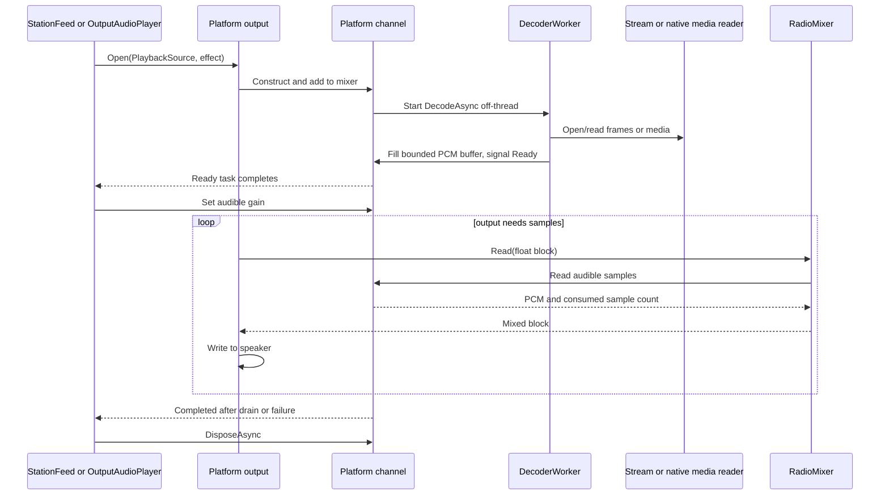

# Audio transport, decoding, buffering, and mixing

[Overview](../overview.md) | [Failure/lifecycle trace](../investigations/errors-and-lifecycle.md)

## Purpose and structure

Both Radio and Library use the same platform output/channel implementations. Each active owner creates its own output instance. Radio can mix several neighbor channels plus static/tone; Library uses one channel without station effects.

| Layer | Source / responsibility |
|---|---|
| Contracts | [IRadioAudioOutput.cs](../../../src/JellyJam.Core/Abstractions/IRadioAudioOutput.cs): output volume/noise/tone/Open/dispose; channel gain/Ready/Completed/Position/dispose. |
| Source description | [PlaybackSource.cs](../../../src/JellyJam.Core/Models/PlaybackSource.cs): format, URI, transient credentials/session, start position, provider stream source, optional buffered frames. |
| Provider transport | [IMp3Frames.cs](../../../src/JellyJam.Core/Audio/IMp3Frames.cs), [ResumableMp3Reader.cs](../../../src/JellyJam.Core/Audio/ResumableMp3Reader.cs), [Mp3FrameReader.cs](../../../src/JellyJam.Core/Audio/Mp3FrameReader.cs): frame contract, resumable provider reader, and stream frame parsing. |
| Compressed reserve | [AudioReadAhead.cs](../../../src/JellyJam.Core/Audio/AudioReadAhead.cs): duration-bounded frame producer across scheduled track boundaries. |
| Decoder lifetime | [DecoderWorker.cs](../../../src/JellyJam.Core/Audio/DecoderWorker.cs): off-thread decoder and bounded shutdown wait. |
| Windows | [NAudioRadioChannel.cs](../../../src/JellyJam.Infrastructure.Windows/Audio/NAudioRadioChannel.cs), [NAudioRadioOutput.cs](../../../src/JellyJam.Infrastructure.Windows/Audio/NAudioRadioOutput.cs): decode/buffer, shared-mode WASAPI speaker. |
| Android | [AndroidRadioChannel.cs](../../../src/JellyJam.MAUI/Platforms/Android/AndroidRadioChannel.cs), [AndroidRadioOutput.cs](../../../src/JellyJam.MAUI/Platforms/Android/AndroidRadioOutput.cs): MediaCodec/MediaExtractor decode, ring buffer, AudioTrack feeder and focus. |
| Mix/effects | [RadioMixer.cs](../../../src/JellyJam.Core/Audio/RadioMixer.cs), [EffectProcessor.cs](../../../src/JellyJam.Core/Audio/EffectProcessor.cs): 44,100 Hz stereo float, per-input effects and gain ramps, pink noise and connecting tone. |

## Format dispatch and side effects

Channel construction starts DecoderWorker immediately, initially at zero gain. Mp3/Broadcast paths decode frames; Media paths open a platform-supported unauthenticated URI/file. BufferedFrames takes precedence over provider transport; provider transport takes precedence over fallback HTTP. This prevents Plex playback from accidentally entering Jellyfin's authenticated HTTP path.

For authenticated Jellyfin, Resolve negotiates direct MP3 or server MP3 transcode, capped at 320 kbps/two channels. That policy is **not** a blanket rule that all local, podcast, or internet input must be transcoded by Jellyfin. Media Foundation and Android media APIs handle their own supported Media formats.

Decoding does not mean samples have reached the speaker. Ready represents enough buffered data (nominally **400 ms**, with end-of-stream handling); Completed is signaled when decoded data has been consumed or an error reaches the terminal path. Channel Position measures samples consumed, not wall-clock time or necessarily the original file's absolute offset.

## Buffers and threading

- Decoded channel capacity is **six seconds**. A gain-zero channel is normally unread after the mixer's fade-out block, so decoding eventually waits for buffer capacity.
- Scheduled provider MP3 read-ahead targets **two minutes** when audible and **six seconds** when warm. This is compressed in-memory streaming reserve, not a persistent audio download feature.
- Mixer.Read runs on one audio thread. Inputs are replaced under a lock; gains/volume use atomic-style fields. It ramps gains over a block, adds static/tone, applies overall volume, then clamps samples.
- Windows output opens WASAPI and starts Play in its constructor. Library must set noise/tone to zero on its newly created output.
- Android owns one dedicated feeder thread per output. It repeatedly reads **1024 stereo frames** and makes blocking AudioTrack writes.
- DecoderWorker cancellation waits up to **two seconds** for worker cleanup. A blocked native call can outlive DisposeAsync's return; cleanup continues on the worker instead of disposing native resources concurrently with a read.

## Execution flow

Gain may be assigned before Ready (Library does so); this diagram separates conceptual readiness and audibility rather than imposing a universal callback ordering.

## Error handling and observability

Channel decode failures fault Ready and/or Completed according to buffer state. Owners decide skip/retry/fatal behavior. Windows output creation maps device errors to a friendly exception.

**Important gap:** IRadioAudioOutput has no terminal failure event. Android Feed breaks on negative write or exception without informing Core. Interrupted is for permanent focus loss, not speaker write failure. Therefore a playing snapshot is not proof that the output feeder is alive. The inspected Windows output does not wire an equivalent device-terminal callback.

Native format support, device loss, driver behavior, and actual audible results were not exercised for this task. Detailed parser/reconnect/frame-alignment algorithms were navigated at their caller boundary, not exhaustively verified.

## Extension points

An output implementation must supply the existing channel contract, off-thread decode, coherent Ready/Completed and cancellation, bounded buffering, and source-format handling. Provider MP3 transport can be replaced through IMp3StreamSource rather than changing every platform decoder. A station effect belongs in the existing effect enum/processor/editor choices, not the view model's sample handling.

## Investigation guide

For silence: check owner, gain, Ready, available PCM, mixer Read, then native write. For stale audio: inspect generation/worker disposal in selected playback or timeline drift/rejoin in StationFeed. For slow close: inspect DecoderWorker's worker and Android feeder join separately.

Test anchors: [AudioReadAheadTests.cs](../../../tests/JellyJam.Core.Tests/AudioReadAheadTests.cs), [DecoderWorkerTests.cs](../../../tests/JellyJam.Core.Tests/DecoderWorkerTests.cs), [AudioPipelineTests.cs](../../../tests/JellyJam.Infrastructure.Windows.Tests/AudioPipelineTests.cs), [RadioMixerTests.cs](../../../tests/JellyJam.Infrastructure.Windows.Tests/RadioMixerTests.cs). LiveAudio tests require an actual output device.
