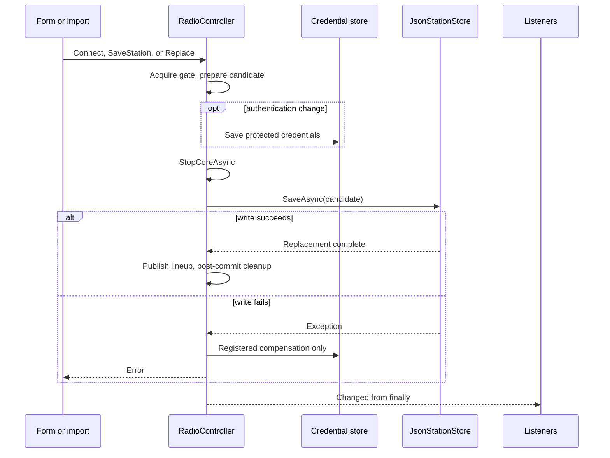

# Accounts, configuration, and persistence

[Overview](../overview.md) | [State/storage catalog](../data-flow.md) | [Account and import trace](../investigations/accounts-and-stations.md)

## Purpose and structure

Configuration keeps user-authored station/account settings durable while separating access credentials. It also provides explicitly non-authoritative metadata caches. There is no database or ORM in the inspected active composition.

| Component | Responsibility |
|---|---|
| [RadioLineup.cs](../../../src/JellyJam.Core/Radio/RadioLineup.cs) | Returns candidate lineups, validates frequencies/source relationships, removes dependent stations. |
| [RadioController.cs](../../../src/JellyJam.Core/Radio/RadioController.cs) | Serializes edits, stages authentication effects, stops old tuner, saves/publishes, runs compensation and post-commit work. |
| [JsonStationStore.cs](../../../src/JellyJam.Core/Configuration/JsonStationStore.cs) | Load/read/validate/save/write format; migration to current version 2. |
| [IServerCredentialStore.cs](../../../src/JellyJam.Core/Abstractions/IServerCredentialStore.cs) | Local-server-ID keyed protected token operations. |
| [WindowsServerCredentialStore.cs](../../../src/JellyJam.Infrastructure.Windows/Security/WindowsServerCredentialStore.cs) | DPAPI CurrentUser protected server-token map, serialized through its semaphore. |
| [SecureServerCredentialStore.cs](../../../src/JellyJam.MAUI/Services/SecureServerCredentialStore.cs) | Per-server SecureStorage values on Android. |
| [DataTransfer.cs](../../../src/JellyJam.MAUI/Services/DataTransfer.cs) | User file picker/saver and staged authorization for replacement import. |
| [JsonLibraryIndexStore.cs](../../../src/JellyJam.Core/Configuration/JsonLibraryIndexStore.cs), [JsonLibraryShelfStore.cs](../../../src/JellyJam.Core/Configuration/JsonLibraryShelfStore.cs), [JsonTrackListCache.cs](../../../src/JellyJam.Core/Configuration/JsonTrackListCache.cs) | Separate metadata persistence policies, not one transaction. |

## Validation and commit behavior

RadioLineup.WithStation validates FM channel range/spacing, nonempty call sign, unique frequency, provider existence, supported kind/shuffle, feed limits, and source-specific stream/library constraints. Settings loading rebuilds the lineup through these rules.

[src/JellyJam.Core/Radio/RadioController.cs](../../../src/JellyJam.Core/Radio/RadioController.cs) -> `RadioController.EditAsync()` owns the commit sequence:

1. Acquire gate and require successful LoadAsync.
2. Build/validate candidate; authentication or source validation can run here.
3. Stop the old Radio tuner.
4. Save candidate through IStationStore.
5. Replace in-memory lineup only after save succeeds.
6. Cancel obsolete warmups and run post-commit revocation/cache actions.
7. Release gate and publish Changed in finally.

Preparation failure normally preserves running Radio. Save failure occurs **after** Stop and can leave Radio stopped with the old lineup. A Changed event does not by itself mean a successful edit.

EditScope tracks newly created credential IDs, rollback functions, and after-commit steps. Compensation/cleanup catches are often silent. Plex reconnect records prior credentials; Jellyfin merge SignInAsync records deletion only for newly created identities, leaving the review's reused-credential rollback gap.

## Edit execution flow

## Files versus secrets

JsonStationStore writes a uniquely named temporary file then moves it over the destination. Missing data is empty; corrupt authoritative data is a blocking error with repair guidance. It does not silently reset the lineup.

Windows credentials are in **server-credentials.dat**, not the older single-login credentials.dat described by legacy paths. A read/decryption failure raises a friendly error; updates can discard permanently unreadable encrypted/JSON state to permit a new login. Plaintext buffers are cleared after encrypt/decrypt use.

Android keys use the local server GUID. Permanent keystore corruption deletes that key and returns no login; other failures propagate. Passwords are transient form/import input; Plex account/server token material remains in the protected credential store.

Index cache identity hashes local account ID, server URL, and user ID. Index load tolerates invalid/unreadable cached data with a warning; save accepts complete snapshots only. Track-list cache reads can silently fall back to empty. Shelf writes are deferred by LibraryShelves, unlike the awaited lineup commit.

## Import/export

DataTransfer.ExportAsync serializes RadioLineup.ForExport to the user-selected file. Tokens are not part of RadioLineup. ForExport additionally removes remembered Plex endpoint and HTTP consent. It is **not anonymization**: Jellyfin addresses/account names and device-folder metadata can remain.

DataTransfer.ImportAsync parses/validates, collects Jellyfin login prompts and Plex authorizations, and calls **RadioController.ReplaceAsync**. Cancellation during prompts leaves the existing lineup unapplied. Replacement builds fresh account mapping, preserves station IDs, commits the new lineup, then cleans up old credentials/caches and updates the dial.

RadioController.ImportAsync is a separate **merge** API: maps/reuses accounts and replaces frequency collisions. Do not confuse its rollback behavior with the current MAUI replacement path.

## Extension points

Use existing stores/interfaces and constructor registration in MauiProgram or Console.Program. New authoritative fields need defaults, validation, backward-compatible loading, export review, and round-trip tests. New credentials belong behind IServerCredentialStore, not generic JSON. A new persistence capability must explicitly identify whether callers await a durable write or only schedule one.

## Investigation guide

Inspect candidate/current lineup and whether StopCoreAsync has already run. For missing login inspect local server identity mapping without exposing stored token values. For cache problems identify account key versus station key and whether post-commit clearing ran. Long authentication/probe work inside the edit gate can delay Start/Stop.

See [RadioControllerTests.cs](../../../tests/JellyJam.Core.Tests/RadioControllerTests.cs), [PlexControllerTests.cs](../../../tests/JellyJam.Core.Tests/PlexControllerTests.cs), [PlexPersistenceTests.cs](../../../tests/JellyJam.Core.Tests/PlexPersistenceTests.cs), and [CredentialStoreTests.cs](../../../tests/JellyJam.Infrastructure.Windows.Tests/CredentialStoreTests.cs). Single-file replacement is not proof of atomic multi-store updates or crash-safe shelf flushing.
