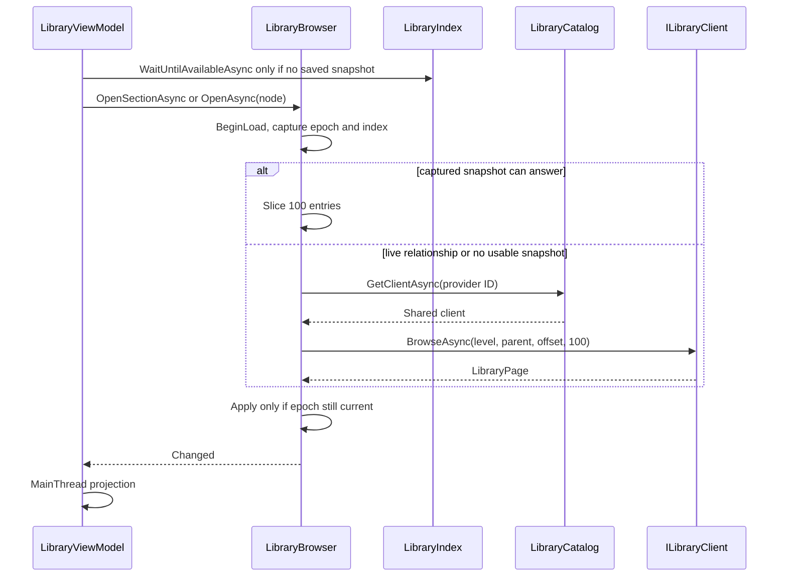

# Library browsing, indexing, search, and shelves

[Overview](../overview.md) | [Browse/search trace](../investigations/library-browse-search.md) | [Artwork/shelves trace](../investigations/artwork-and-shelves.md)

## Purpose

Library makes connected Jellyfin accounts and configured Local Device collections browsable without owning their playback sequences. It supplies metadata, scope selections, and optional artwork to presentation and LibraryPlayer. Its saved index contains metadata only; local music plays from the original device files.

## Structure

| Component | Responsibility |
|---|---|
| [LibraryModels.cs](../../../src/JellyJam.Core/Library/LibraryModels.cs), [LibraryBrowseState.cs](../../../src/JellyJam.Core/Library/LibraryBrowseState.cs) | Provider/node/page/section/action vocabulary and browser state. |
| [LibraryCatalog.cs](../../../src/JellyJam.Core/Library/LibraryCatalog.cs) | Enumerates lineup.Servers, turns provider GUIDs into stable IDs, and shares a lazy client per provider kind. |
| [LocalLibraryClient.cs](../../../src/JellyJam.Core/Library/LocalLibraryClient.cs) | Adapts platform device metadata and stream resolution to library categories, scopes and paging, without credentials. |
| [LibraryIndex.cs](../../../src/JellyJam.Core/Library/LibraryIndex.cs) | Starts/cancels account scan jobs, reports progress, publishes last complete snapshot. |
| [LibraryIndexSnapshot.cs](../../../src/JellyJam.Core/Library/LibraryIndexSnapshot.cs) | Answers section/node/track queries from a complete set of metadata sections. |
| [LibraryBrowser.cs](../../../src/JellyJam.Core/Library/LibraryBrowser.cs) | Provider, hierarchy, back stack, list pagination, Now Playing return view, small-artwork cache. |
| [LibrarySearch.cs](../../../src/JellyJam.Core/Library/LibrarySearch.cs) | Pure ranked text matching over a snapshot. |
| [LibraryDiscovery.cs](../../../src/JellyJam.Core/Library/LibraryDiscovery.cs) | Random album selection and choosing covers for entries. |
| [LibraryShelves.cs](../../../src/JellyJam.Core/Library/LibraryShelves.cs) | Favorites/recent metadata, observes Library starts, schedules persistence. |
| [NowPlayingArtwork.cs](../../../src/JellyJam.Core/Library/NowPlayingArtwork.cs) | Shared bounded current-track artwork fetches; separate from browser artwork cache. |

## Behavior and ownership

Catalog exposes Jellyfin and LocalDevice entries in RadioLineup.Servers. Existing records default to Jellyfin. Local entries carry a folder URI/name and optional alias; they do not load credentials or create network clients. Windows uses TagLibSharp and Android uses MediaMetadataRetriever for file tags. LocalLibraryClient derives stable artist/album/genre IDs, shares one metadata scan, and delegates playback to the existing device IStationSource. Only the platform implementations access files or Android content URIs.

Aliases affect display only: changing one preserves provider identity, clients and index jobs. Folder changes invalidate local indexes. Catalog does not enumerate PlexServers, podcast feeds, or internet streams. Missing provider/login is a domain error. A caller can cancel its wait without cancelling shared client creation. Faulted entries are removed for later retry.

### Index lifecycle

[src/JellyJam.Core/Library/LibraryIndex.cs](../../../src/JellyJam.Core/Library/LibraryIndex.cs) -> `LibraryIndex.Sync()` starts jobs for new/changed accounts and drops obsolete jobs. Each job:

1. Loads an account-scoped complete saved snapshot, if available.
2. Resolves the account client and reads each Library section in **500-entry pages**.
3. Deduplicates IDs; a repeated page with no fresh IDs while HasMore is true fails the scan.
4. Constructs a replacement snapshot, saves it, then publishes it and marks Ready.

Indexing/Ready/Failed is job status, not browser or playback status. Failed refresh can coexist with an available old snapshot. Retry only starts a Failed job; reopening a provider invokes it. Cancellation of a modal wait is not cancellation of indexing. Dispose cancels jobs but offers no asynchronous join.

### Browsing

Browser state is protected by a lock. New navigation cancels prior work and increments an epoch. Only the current epoch may publish; paging uses the captured listIndex so a refreshed index does not change the list halfway through.

Pages contain **100 nodes**. Snapshot answers are used when possible, except children of an artist explicitly go to the server. Hierarchy includes artist -> albums, album -> songs, genre -> artists. Back from an album prefers its artist, from an artist goes to sections, otherwise uses captured history. Now Playing keeps a return view; background loads may update that return view.

ReadListTracksAsync reads the whole scope when more pages exist, rather than treating the currently rendered rows as the entire sequence.

The browser constructor establishes a root/provider choice, but [LibraryViewModel.cs](../../../src/JellyJam.MAUI/ViewModels/LibraryViewModel.cs) immediately shows Now Playing during application composition. OpenProvider explicitly returns to the account's sections/front page.

### Search, front page, favorites

Search covers artists, albums, and songs, not genres. It ignores case and accents, ranks exact/prefix/word/substring/related metadata matches, and returns at most **20** by default. The UI debounces **150 ms** and cancels obsolete searches; no index means an explanatory message, not a remote-search fallback.

[LibraryHomeViewModel.cs](../../../src/JellyJam.MAUI/ViewModels/LibraryHomeViewModel.cs) requests recently added albums when the front page opens and draws random albums from the saved index. Default shelf size is **12**. Favorites are local artists/albums/songs, not genres. Recent entries are capped at **20 globally**, then filtered by provider for display; repeated track starts are suppressed using lastRecorded.

## Execution flow

## Side effects and failures

Provider selection writes a preference. Indexing writes JSON before publishing; favorite/recent changes schedule off-thread JSON writes. Browser errors become state.Message; index errors log a type and mark Failed. Artwork is decorative and may return null.

Browser ReadArtworkAsync copies the entire body before checking **2 MiB**, and caches up to 300 entries. NowPlayingArtwork enforces its 2 MiB bound during reading and shares up to eight remembered fetch tasks. These are different mechanisms, not interchangeable guarantees.

## Extension points

ILibraryClient is the browsing/stream contract, with optional artwork/recent-album defaults. A second browsable provider also needs catalog discovery/client-factory and index/store identity work because those currently take RadioServer/PlayerConfiguration. Registering IStationSource alone does not expose a provider in Library.

## Investigation guide

Start at LibraryViewModel command, WaitForIndexAsync, Browser.Navigate/ReadPageAsync/Apply, Index.Progress/Snapshot, then JellyfinClient.BrowseAsync. Inspect provider IDs and epoch before investigating row binding. For missing favorites inspect metadata scope and deferred writes; for missing covers identify which artwork cache is involved.

Existing test anchors: [LibraryBrowserTests.cs](../../../tests/JellyJam.Core.Tests/LibraryBrowserTests.cs), [LibraryIndexPersistenceTests.cs](../../../tests/JellyJam.Core.Tests/LibraryIndexPersistenceTests.cs), [LibrarySearchTests.cs](../../../tests/JellyJam.Core.Tests/LibrarySearchTests.cs), and [LibraryShelvesTests.cs](../../../tests/JellyJam.Core.Tests/LibraryShelvesTests.cs). Complex parser/SDK internals are outside this document's inspected boundary.
