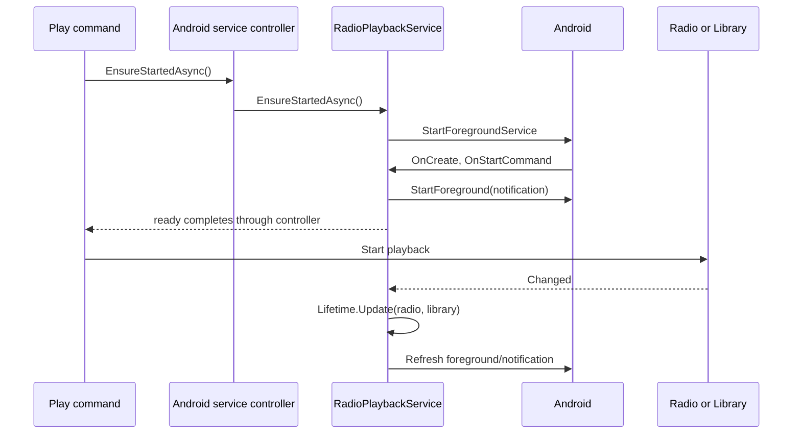

# Native lifecycle, media controls, windows, ads, and diagnostics

[Overview](../overview.md) | [Lifecycle investigation](../investigations/errors-and-lifecycle.md)

## Purpose and structure

These adapters connect the shared application to OS lifetime, media focus, window policy, protected services, and diagnostics. They affect playback/privacy as well as appearance.

| Component | Responsibility |
|---|---|
| [IPlaybackServiceController.cs](../../../src/JellyJam.MAUI/Services/IPlaybackServiceController.cs) | Presentation-facing EnsureStartedAsync/Stop contract. |
| [RadioPlaybackService.cs](../../../src/JellyJam.MAUI/Platforms/Android/RadioPlaybackService.cs) | Android foreground notification, MediaSession, noisy receiver, static startup handshake. |
| [PlaybackServiceLifetime.cs](../../../src/JellyJam.MAUI/Services/PlaybackServiceLifetime.cs) | Foreground policy over Radio and Library activity, with startup grace before either first becomes active. |
| [AndroidRadioOutput.cs](../../../src/JellyJam.MAUI/Platforms/Android/AndroidRadioOutput.cs) | Audio focus and output feeder lifetime. |
| [WindowsPlaybackServiceController.cs](../../../src/JellyJam.MAUI/Platforms/Windows/WindowsPlaybackServiceController.cs) | No-op: Windows app keeps running while minimized. |
| [PhoneWindow.cs](../../../src/JellyJam.MAUI/Platforms/Windows/PhoneWindow.cs), [DesktopLayoutMetrics.cs](../../../src/JellyJam.MAUI/Services/DesktopLayoutMetrics.cs), [ScaledView.cs](../../../src/JellyJam.MAUI/Platforms/Windows/ScaledView.cs) | Native frame/drag/resize, DPI/work-area limits, scaled page content. |
| [AndroidAdService.cs](../../../src/JellyJam.MAUI/Platforms/Android/AndroidAdService.cs), [AdBannerViewHandler.cs](../../../src/JellyJam.MAUI/Platforms/Android/AdBannerViewHandler.cs) | Ads/UMP callbacks and native banner request lifecycle. |
| [SafeTask.cs](../../../src/JellyJam.MAUI/Services/SafeTask.cs), [TraceLoggerBridge.cs](../../../src/JellyJam.MAUI/Platforms/Windows/TraceLoggerBridge.cs), [LogSanitizer.cs](../../../src/JellyJam.MAUI/Services/LogSanitizer.cs) | Best-effort exception logging and Windows sanitized Trace -> ILogger bridge. |

## Android startup and media behavior

Play commands request notification permission on Android 13+ and await the service **before** constructing playback output. EnsureStartedAsync calls StartForegroundService on MainThread and waits up to ten seconds for ready. OnCreate resolves RadioController/LibraryPlayer from MauiProgram.Services, creates notification channel/MediaSession, registers the noisy receiver, and subscribes to both owners.

OnStartCommand promotes to foreground then completes ready. Promotion failure faults the waiting caller and stops the service. It returns NotSticky.

PlaybackServiceLifetime.Update returns active if either owner is active, or if neither has ever become active during this service lifetime. This prevents the pre-playback startup window from immediately losing foreground status. After playback has happened, both owners inactive means detach foreground status.

### Playback-service execution flow

### Current routing discrepancy

Lifetime, noisy receiver, and normal service destruction consider **both** players. However:

- HandleCommand play/stop/next/previous calls RadioController only.
- MediaSession Controls.OnPause calls Radio.StopAsync; it does not pause/resume Library.
- Describe/CreateNotification read RadioSnapshot, even when Library is the active owner.

Thus correct foreground lifetime does not imply correct owner-aware controls or metadata. This is the supplied review's MIN-002, not a capability promised by the notification.

OnDestroy unsubscribes and starts asynchronous stops for both owners unless a newer service instance supersedes it; it then releases receiver/session and removes notification state. These tasks are not synchronously joined.

### Audio focus

Audio gain restores on focus gain, scales to 0.2 for ducking, and scales to zero for transient loss while streams continue. Permanent loss raises Interrupted; the factory-supplied callback stops that particular owner. The becoming-noisy receiver stops both players. Focus mute is not a stored pause/resume cursor.

## Windows behavior

PhoneWindow keeps the standard native border and title bar (minimize and close; maximize is disabled), disables maximizing, and recalculates limits with monitor DPI/work area. Current DesktopLayoutMetrics has default 412 x 892, **maximum width 412**, minimum 320 x 600 (reduced if the work area cannot accommodate it), and a 48-pixel logical height margin. Content scales down, never above 1.

The [README](../../../README.md) and [AppLaunchTests.cs](../../../tests/JellyJam.E2E.Windows.Tests/AppLaunchTests.cs) still mention/expect an 824-wide maximum. Treat source as the current implementation, not proof that those expectations pass.

App.CreateWindow's Destroying handler stops the service controller and disposes Radio. The Windows controller's Stop is empty; there is no explicit Library/index/shelf join/flush there. Minimization/foreground loss only changes visual activity.

## Ads: visibility is not request authorization

RadioViewModel initializes ads after station load and computes ShowAd from content/readiness/consent visibility policy. AndroidAdService initializes MobileAds and requests UMP consent information; success reads CanRequestAds and privacy-options status.

**Current defect:** eligibility starts true and update failure sets true. EnsureConsentAsync does not load/show a required consent form. The native banner handler creates an AdRequest when width/unit ID permit, without consulting IAdService at that boundary. A visibility predicate is not proof that no network request occurred. This repeats observed source behavior from review MIN-001, not legal advice or a validated consent integration.

Windows uses NoopAdService. Real consent forms, banner requests, store compliance, and device-specific behavior were not exercised.

## Diagnostics, extension, and investigation

TraceLoggerBridge is intentionally one-way; a forwarding guard prevents recursive logging. SafeTask writes exception type/caller to stderr and suppresses failures where no caller can receive them. Core also has warning and silent cleanup paths; no single log sink sees everything.

Platform replacements are registered conditionally in MauiProgram. New OS media behavior must inspect all command origins and owner snapshots, not only the page buttons. For foreground failures break at service ready/promote/refresh, lifetime.hasPlayed, and active owner state; for silent output inspect AndroidRadioOutput.Feed, which currently does not publish terminal write failures.

Test anchors: [PlaybackServiceLifetimeTests.cs](../../../tests/JellyJam.MAUI.Tests/PlaybackServiceLifetimeTests.cs), [DesktopLayoutMetricsTests.cs](../../../tests/JellyJam.MAUI.Tests/DesktopLayoutMetricsTests.cs), [WindowsLoggingTests.cs](../../../tests/JellyJam.MAUI.Tests/WindowsLoggingTests.cs), and [AppLifecycleTests.cs](../../../tests/JellyJam.Integration.Android.Tests/AppLifecycleTests.cs). These are not substitutes for device focus/notification/driver testing.
