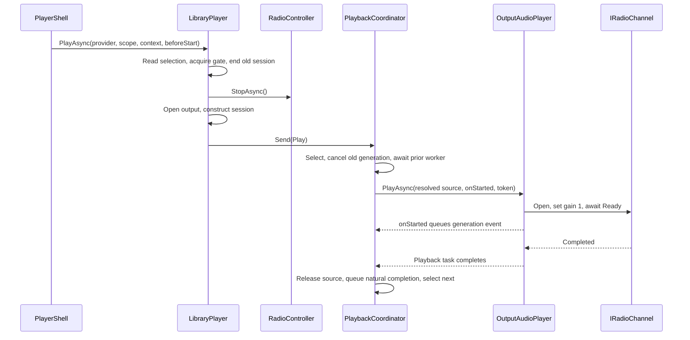

# Selected-track playback and shell ownership

[Overview](../overview.md) | [End-to-end playback trace](../investigations/library-playback.md)

## Purpose and structure

This subsystem turns a user's Library selection into a sequence with history and modes. It is **not** the engine behind today's station dial.

| Component | Responsibility |
|---|---|
| [PlayerShell.cs](../../../src/JellyJam.Core/Playback/PlayerShell.cs) | Displayed mode; ordered Radio/Library handoff; remembers last Library request for replay; locates sounding Jellyfin tracks. |
| [LibraryPlayer.cs](../../../src/JellyJam.Core/Library/LibraryPlayer.cs) | Resolve selection before disturbing playback; own session/coordinator/output; poll and publish LibrarySnapshot. |
| [PlaybackCoordinator.cs](../../../src/JellyJam.Core/Playback/PlaybackCoordinator.cs) | Serialize commands/track events; generation cancellation; worker chaining; transient retry and source release. |
| [TrackSelector.cs](../../../src/JellyJam.Core/Playback/TrackSelector.cs) | Pure ordering, traversal, confirmed/pending history, failures, random/repeat scope. |
| [OutputAudioPlayer.cs](../../../src/JellyJam.Core/Playback/OutputAudioPlayer.cs) | Adapt IAudioPlayer to one gain-1 channel on an existing IRadioAudioOutput. |
| [PlayerAction.cs](../../../src/JellyJam.Core/Models/PlayerAction.cs), [PlayerStatus.cs](../../../src/JellyJam.Core/Models/PlayerStatus.cs), [PlaybackSnapshot.cs](../../../src/JellyJam.Core/Models/PlaybackSnapshot.cs) | Commands and snapshot vocabulary; no Pause or Seek action. |

## Behavior

[src/JellyJam.Core/Library/LibraryPlayer.cs](../../../src/JellyJam.Core/Library/LibraryPlayer.cs) -> `LibraryPlayer.PlayAsync()` accepts provider, optional scope, optional full song-list context, cancellation, and a beforeStart callback. It reads/deduplicates playable tracks **before** acquiring its gate. Invalid/empty selections leave existing playback alone.

Inside the gate it ends its prior session, invokes Radio Stop through beforeStart, opens output at current shared volume with noise/tone zero, creates coordinator and session, sends Play, publishes a snapshot, and starts polling. Failure after old playback stops can leave both owners inactive; preserving old playback is guaranteed for selection validation, not every output/I/O failure.

The session poll interval is 250 ms. Notifications avoid repeated sub-second position changes. A terminal Stopped/Error snapshot is marked Finished and the session/output released, while the last state remains visible. Explicit Stop releases the session and reports Stopped with zero position.

### Selection rules

TrackSelector normalizes tracks by artist, album, disc, number, ID, deduplicating IDs. Random modes shuffle a traversal, not independent draws with replacement. Artist/Album random scopes and Album repeat are anchored to the selected track. Song repeat affects **natural completion**; explicit Next still advances.

An entered track is pending until audio reports Started. DiscardPending prevents a cancelled load from becoming false playback history. Previous traverses confirmed history; a pending load is discarded first. Failed IDs are excluded. In sequential mode, Begin on a chosen track continues after it and then wraps to earlier candidates.

### Coordination and resource ordering

Coordinator has a single-reader message channel for actions, mode changes, library replacement, Started, failure, and natural completion. A generation ID invalidates stale worker callbacks. Starting a track cancels the old load and chains the new worker to the previous worker, so audio disposal/release completes before the next opens.

Resolve can use a prefetched next stream. Track execution retries up to three attempts for transient errors, with 250/500 ms delays. Auth/fatal failures become Error; nonfatal track failures are marked and skipped. Release uses a two-second cleanup token and suppresses cleanup failures. Retry status can be published by the worker, outside the message consumer.

## Shell is not an atomic audio arbiter

SetMode changes only the displayed mode. StartRadioAsync awaits Library.StopAsync then Radio.StartAsync. PlayLibraryAsync passes Radio.StopAsync into LibraryPlayer. Radio.Changed additionally starts a best-effort Library stop if both already report active.

There is no single shared transition lock. A direct Radio start can occur after beforeStart but before Library publishes itself active. The supplied review's ARCH-001 probe established simultaneous Core ownership; it did not measure physical sound overlap. The Android media service contains direct Radio entry points.

## Extension points

Use PlayerShell for existing host-level owner transitions, LibraryPlayer for Library operations, ITrackStreams for resolving/releasing, and IAudioPlayer for coordinator testing. A new action requires command handling, selector semantics if applicable, UI/platform routing, and tests; adding an enum value alone is not implementation.

Older [RadioSession.cs](../../../src/JellyJam.Core/Playback/RadioSession.cs) and [NAudioPlayer.cs](../../../src/JellyJam.Infrastructure.Windows/Audio/NAudioPlayer.cs) remain in source but are not constructed by the inspected current MAUI/CLI roots. Their resume/config behavior must not be described as active Library restoration.

## Investigation guide

Watch LibraryPlayer.session/Snapshot, coordinator generation/worker/load, selector cursor/pending/upcoming/failed, and channel Ready/Completed. For a Next problem distinguish explicit Next from natural completion and determine whether UI currently controls Radio.

Use [PlaybackCoordinatorTests.cs](../../../tests/JellyJam.Core.Tests/PlaybackCoordinatorTests.cs), [TrackSelectorTests.cs](../../../tests/JellyJam.Core.Tests/TrackSelectorTests.cs), [LibraryPlayerTests.cs](../../../tests/JellyJam.Core.Tests/LibraryPlayerTests.cs), and [PlayerShellTests.cs](../../../tests/JellyJam.Core.Tests/PlayerShellTests.cs). Sequential handoff tests do not establish all concurrent interleavings.
