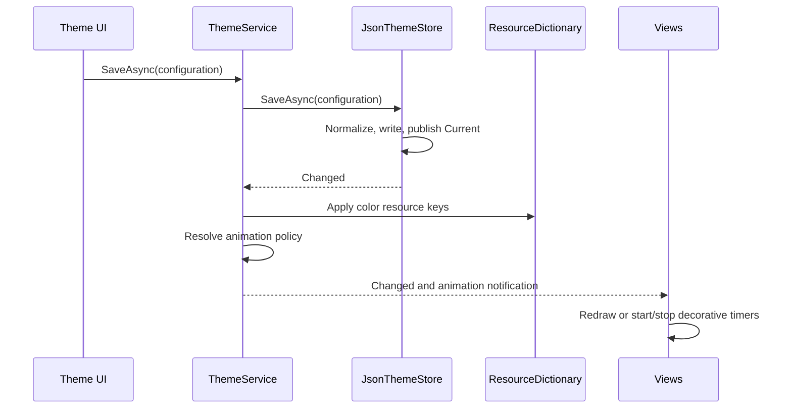

# Presentation, navigation, appearance, and terminal host

[Overview](../overview.md) | [Feature development](../feature-development.md)

## Purpose

Presentation projects Core snapshots into controls, keeps transient form/navigation state, and forwards operations. It does not select tracks or decode samples. The source contains substantial visual code; this guide follows its control/data boundaries rather than every drawing algorithm.

## Structure

| Component | Responsibility |
|---|---|
| [App.cs](../../../src/JellyJam.MAUI/App.cs) | Theme/resource setup, NavigationPage/Window creation, app foreground callbacks. |
| [RadioPage.xaml.cs](../../../src/JellyJam.MAUI/Views/RadioPage.xaml.cs), [RadioPage.xaml](../../../src/JellyJam.MAUI/Views/RadioPage.xaml) | Shared shell, Library bindings, embedded settings/guide overlays, foreground visual activity. |
| [RadioViewModel.cs](../../../src/JellyJam.MAUI/ViewModels/RadioViewModel.cs) | Radio snapshot, power/dial/mode commands, spectrum permission request, ads visibility, artwork offer. |
| [LibraryViewModel.cs](../../../src/JellyJam.MAUI/ViewModels/LibraryViewModel.cs), [LibraryView.xaml](../../../src/JellyJam.MAUI/Views/LibraryView.xaml) | Browser and player projections, index wait, owner-aware transport, menus and station-from-context requests. |
| [LibrarySearchViewModel.cs](../../../src/JellyJam.MAUI/ViewModels/LibrarySearchViewModel.cs), [LibraryHomeViewModel.cs](../../../src/JellyJam.MAUI/ViewModels/LibraryHomeViewModel.cs) | Search cancellation/debounce and front-page carousel projections. |
| [StationsViewModel.cs](../../../src/JellyJam.MAUI/ViewModels/StationsViewModel.cs) | Source-dependent form state, permissions, validation, add/edit/remove/import/export commands. |
| [IServerProvider.cs](../../../src/JellyJam.MAUI/Services/IServerProvider.cs), [AddServerPage.cs](../../../src/JellyJam.MAUI/Views/AddServerPage.cs) | Extensible MAUI account connection forms, including multi-step Plex flow. |
| [ThemeService.cs](../../../src/JellyJam.MAUI/Services/ThemeService.cs), [Styles.xaml](../../../src/JellyJam.MAUI/Styles.xaml) | Shared dynamic resource colors, theme events, power-saving animation policy. |
| [ArtworkSlot.cs](../../../src/JellyJam.MAUI/ViewModels/ArtworkSlot.cs) | Current artwork request/projection, feeding ThemeService for the artwork palette. |

## Behavior and state propagation

CommunityToolkit observable properties and RelayCommand attributes generate public properties/commands. To find the behavior of PlayNodeCommand, inspect its backing PlayNode method; do not expect a checked-in command declaration.

Core Changed events commonly arrive on workers. Radio/Library view models use MainThread.BeginInvokeOnMainThread before changing UI projections. Their collections and busy/error fields are presentation state; Core owns lineup, sequence, and sessions.

The shared Radio | Library mode preference changes visibility only. Settings is an embedded panel, not a second independent playback owner. Deeper pages use NavigationPage. Library has its own Core browser history within the page.

LibraryViewModel's transport checks the audible owner: while Radio controls are active, Next/Previous change station; otherwise they send Library track actions. This differs from Android's still-Radio-only media notification controls.

Station creation builds RadioStation using StationSourceRules, source choice, selected server/libraries, filters, feed limits, folder, effect, and shuffle. It asks for HTTP confirmation and Android music permission where relevant, then invokes RadioController.SaveStationAsync. The controller repeats authoritative validation.

## Appearance execution flow

ThemeService.Attach precedes page construction. JsonThemeStore's load fallback keeps the default usable. Battery saver changes can disable decorative motion unless the user overrides that choice. Artwork palette requests are versioned so old sampling cannot overwrite newer track colors.

Foreground callbacks stop/restart decorative work rather than automatically stopping music. Windows page scaling and window sizing are described in [platform lifecycle](platform-lifecycle.md).

## Errors and side effects

View-model ExecuteAsync methods gate reentrant UI operations and map known exceptions into ErrorMessage. Unexpected Library errors log type/stack without raw network messages. SafeTask handles async-void/platform work with type-only logging; it is not a durable operation or an alert.

Preferences persist shell mode, provider, volume, and selected presentation flags. Themes use JSON. Artwork bytes and most navigation/form state remain memory-only. A failed favorite write is not surfaced through the form's busy/error path.

## Terminal host

[src/JellyJam.Console/PlayerApplication.cs](../../../src/JellyJam.Console/PlayerApplication.cs) -> `PlayerApplication.ListenAsync()` runs a 100 ms polling loop. Keys are drained before tuning once per frame. Spectre live rendering is used when ANSI is available; redirected/no-color output prints changed status lines.

[RadioRenderer.cs](../../../src/JellyJam.Console/Presentation/RadioRenderer.cs) renders current RadioSnapshot. [PlayerRenderer.cs](../../../src/JellyJam.Console/Presentation/PlayerRenderer.cs) remains present, but current CLI station playback is RadioTuner, not PlaybackCoordinator. Terminal startup/settings are separate from MAUI DI and data-directory selection.

## Extension points and investigation guide

Add UI behavior to the existing view model and call Core operations; register pages/view models in MauiProgram using current lifetimes. Reuse source-choice/form helpers instead of encoding provider rules only in XAML. For a custom drawing change inspect its view plus ThemeResources events and foreground hooks.

Break at command backing methods, ExecuteAsync, the Core call, Changed handler, and final projection. If UI freezes, distinguish index modal waiting from native output initialization and MainThread work.

[MAUI.Tests](../../../tests/JellyJam.MAUI.Tests/JellyJam.MAUI.Tests.csproj) links selected helpers and embeds XAML; it does not compile every view/view model. [LibraryPresentationTests.cs](../../../tests/JellyJam.MAUI.Tests/LibraryPresentationTests.cs) contains structural expectations that the supplied review found stale. Actual visual correctness requires a platform build and rendered checks; none were run for this documentation.
