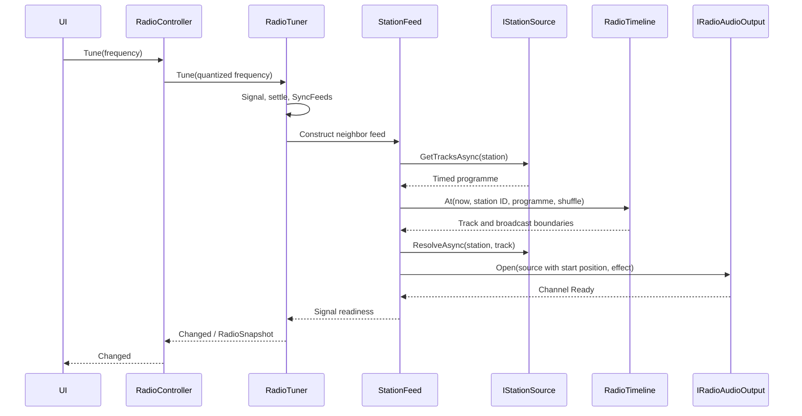

# Station radio

[Overview](../overview.md) | [Tuning execution trace](../investigations/radio-tuning.md)

## Purpose

Radio simulates stations that continue broadcasting while nobody listens. The dial asks what is on air **now**, rather than choosing the next item in a user playlist. Live internet stations use their arriving stream instead of the simulated schedule.

## Structure and state

| Component | Responsibility |
|---|---|
| [RadioController.cs](../../../src/JellyJam.Core/Radio/RadioController.cs) | Owns lineup, edit/start/stop gate, dial, volume, output, connections, tuner task, and podcast warmups. Public facade used by MAUI. |
| [RadioLineup.cs](../../../src/JellyJam.Core/Radio/RadioLineup.cs), [RadioStation.cs](../../../src/JellyJam.Core/Radio/RadioStation.cs) | Validated immutable-style account/station configuration, kind discriminator, filters, effects, shuffle, feed limits. |
| [RadioTuner.cs](../../../src/JellyJam.Core/Radio/RadioTuner.cs) | One run-once signal loop; owns feed neighborhood and published RadioSnapshot. |
| [StationFeed.cs](../../../src/JellyJam.Core/Radio/StationFeed.cs) | One worker per station; programme, current channel/track, readiness, retries, refresh, prefetch, release. |
| [RadioTimeline.cs](../../../src/JellyJam.Core/Radio/RadioTimeline.cs) | Pure time -> track/position mapping for finite programmes. |
| [ShuffleOrder.cs](../../../src/JellyJam.Core/Radio/ShuffleOrder.cs) | Station-specific ordering algorithms; distinct from Library's RandomMode. |
| [TuningMix.cs](../../../src/JellyJam.Core/Radio/TuningMix.cs) | Calculates reception, gain, static, tone, and neighborhood without I/O. |
| [StationSources.cs](../../../src/JellyJam.Core/Radio/StationSources.cs) | Routes source operations by StationKind. |

## Behavior

[src/JellyJam.Core/Radio/RadioController.cs](../../../src/JellyJam.Core/Radio/RadioController.cs) -> `RadioController.StartAsync()` requires a successfully loaded lineup and at least one station. It constructs authenticated connections, optional Plex source, output, lifetime token, and RadioTuner. Changed fires after the transition; output creation failure cleans up connections and propagates.

Tune updates the quantized dial; JumpToStation selects the next/previous configured frequency and wraps. Neither action edits a Library sequence. Stop cancels and awaits the tuner, releases output/connections, then best-effort saves LastFrequency. Editing a lineup also stops Radio once preparation succeeds.

The tuner uses a bounded channel of capacity one with DropWrite: an outstanding signal means "refresh the latest state," not "replay every intermediate dial position." It waits until the dial has settled for **300 ms** before replacing feeds, retaining the nearest station and immediate neighbors (up to three).

TuningMix locks within **0.01 MHz** and fades reception to zero by **0.4 MHz**. A locked unready station produces the connecting tone. A locked failed feed overrides that with static. Changed handlers must be quick; the tuner catches refresh/notification failures to keep its loop alive.

### Scheduled and live programmes

[src/JellyJam.Core/Radio/RadioTimeline.cs](../../../src/JellyJam.Core/Radio/RadioTimeline.cs) -> `RadioTimeline.At()` validates positive durations and unique track IDs, sorts by ID, derives cycle and position from time, and selects an order seeded from version, station GUID, and cycle. Current epoch is 2025-01-01 UTC; version is 1. Input enumeration order is not a source of randomness.

StationFeed joins at the clock-relative position measured after stream resolution. A continuing track boundary can start from zero within three seconds of slack. Retuning an inaudible feed after sufficient drift can reopen it. Deterministic broadcasts agree across installations only when identity, programme/durations, shuffle, and clocks agree.

Live feeds have no timeline/duration. They reconnect on stream termination and rejoin after silence instead of replaying an old buffered broadcast.

### Caches, prefetch, and failures

- Jellyfin, Plex, and Podcast use the station track-list cache; Device and Internet do not.
- A cached programme can play while initial refresh runs. Podcast load may await a registered warmup.
- Finite programmes discard untimed tracks and duplicate IDs. An all-untimed/empty programme is an error.
- Programme refresh is roughly hourly, applied at playback boundaries; failure retains the current programme with a warning.
- Stream resolution can prefetch about 20 seconds before a boundary. Provider MP3 streams can instead participate in compressed read-ahead; see [audio](audio.md).
- Load/resolve retries are bounded to three attempts for transient failures. Finite track failure can skip forward; three consecutive failures stop that feed. Fatal errors stop it immediately.
- Live reconnect failures are counted separately; one minute of healthy reception resets the failure sequence.
- Release uses a two-second token. A feed failure changes the snapshot and reception, not the global Radio power state.

## Execution flow

The detailed [investigation](../investigations/radio-tuning.md) covers power/start, cleanup, persistence, and live variants.

## Extension points

New source behavior goes behind IStationSource; new audio implementations behind IRadioAudioOutput/IRadioChannel. A new StationKind also touches model validation, source dictionary construction, editor rules, serialization compatibility, and tests. A new station shuffle algorithm touches enum, arrangement, editor choices, and deterministic fixtures. Do not route station changes through PlaybackCoordinator merely because it also plays tracks.

## Investigation guide

Break at StartAsync, RadioTuner.Refresh/SyncFeeds, StationFeed.StartProgrammeAsync/AirAsync/BroadcastAsync, and RadioTimeline.At. Inspect IsOn separately from Snapshot.Signal, feed readiness separately from gain, and programme metadata separately from live network health.

Use [RadioTimelineTests.cs](../../../tests/JellyJam.Core.Tests/RadioTimelineTests.cs), [RadioControllerTests.cs](../../../tests/JellyJam.Core.Tests/RadioControllerTests.cs), [RetryAndStartupRaceTests.cs](../../../tests/JellyJam.Core.Tests/RetryAndStartupRaceTests.cs), and [RadioTests.cs](../../../tests/JellyJam.Integration.Windows.Tests/RadioTests.cs). A paused/gain-zero channel is an internal buffer state, not a user-facing Pause feature.
