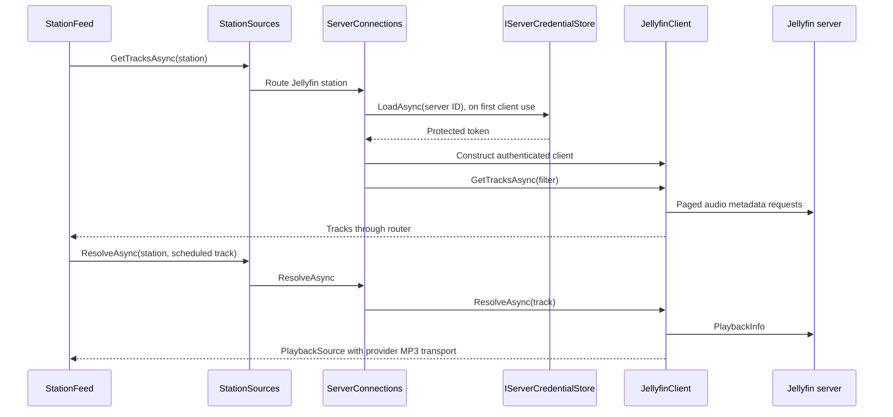

# Source integrations

[Overview](../overview.md) | [Account/station trace](../investigations/accounts-and-stations.md)

## Purpose and shared contract

[src/JellyJam.Core/Abstractions/IStationSource.cs](../../../src/JellyJam.Core/Abstractions/IStationSource.cs) defines GetTracksAsync(station), ResolveAsync(station, track), and ReleaseAsync(station, source). Finite programmes need stable IDs and positive lengths; live stations provide an endless track. [StationSources.cs](../../../src/JellyJam.Core/Radio/StationSources.cs) routes all three operations by StationKind.

Library has a different contract, [ILibraryClient.cs](../../../src/JellyJam.Core/Abstractions/ILibraryClient.cs), for paging, scope tracks, artwork, recent albums, and stream resolution. Only Jellyfin is wired into that browser today.

## Structure and provider behavior

### Jellyfin

- [ServerConnections.cs](../../../src/JellyJam.Core/Radio/ServerConnections.cs) implements IStationSource for Radio. It lazily shares one authenticated client per local server GUID and caches filtered track lists for five minutes using server/filter keys.
- [JellyfinClient.cs](../../../src/JellyJam.Core/Jellyfin/JellyfinClient.cs) implements IRadioClient and ILibraryClient over Jellyfin.Sdk. Authentication returns a populated PlayerConfiguration and token; password is not a saved configuration value.
- GetTracksAsync pages **500** audio items, deduplicates GUIDs, rejects a repeating non-progress page, and maps DTOs to Track. Genres/artists/tags use pipe-delimited filter values.
- ResolveAsync posts PlaybackInfo, chooses MP3 direct play or compatible transcode, retains session identity, and attaches [JellyfinMp3Source.cs](../../../src/JellyJam.Core/Jellyfin/JellyfinMp3Source.cs).
- ResolveStreamUri rejects a different scheme/host/port or embedded user info before forwarding credentials. Authenticated clients disable automatic redirects in the host factory; reverse-proxy path handling lives here.
- ReleaseAsync reports stopped playback when a session ID exists; LogoutAsync revokes the session.
- [JellyfinLibraryClient.cs](../../../src/JellyJam.Core/Jellyfin/JellyfinLibraryClient.cs) is a partial of **the same class**, not another implementation. It handles browse hierarchy, GUID scope validation, artwork, recent albums, and complete selected scopes.

SDK requests have up to two retries after the initial attempt when allowed. Authentication is not retried by that wrapper; 401/403 map to a fatal login/access message, a missing playback item can be nonfatal. Coordinator/feed retries are separate outer layers, so "three attempts" at one layer is not a global HTTP-attempt ceiling.

### Plex

- [PlexConnectionSession.cs](../../../src/JellyJam.Core/Plex/PlexConnectionSession.cs) owns one PIN/discovery/selection/commit attempt. State transitions reject old attempt IDs; Cancel stops pre-commit work, but an already-started commit finishes with CancellationToken.None.
- [PlexPinAuthentication.cs](../../../src/JellyJam.Core/Plex/PlexPinAuthentication.cs), [PlexDiscoveryClient.cs](../../../src/JellyJam.Core/Plex/PlexDiscoveryClient.cs), and [PlexApi.cs](../../../src/JellyJam.Core/Plex/PlexApi.cs) are account authorization, server discovery, and request adapters.
- [PlexSourceFactory.cs](../../../src/JellyJam.Core/Plex/PlexSourceFactory.cs) constructs [PlexStationSource.cs](../../../src/JellyJam.Core/Plex/PlexStationSource.cs) for the controller's current Plex servers.
- PlexStationSource shares connection tasks and five-minute programmes keyed by server/account/library selection/filter. It validates remembered endpoint identity, otherwise rediscovers the machine with saved account credentials.
- HTTPS candidates are preferred; allowed HTTP reconnect is tied to the remembered, explicitly consented endpoint. Server identity is MachineId, not display name.
- Resolve attaches [PlexMp3Source.cs](../../../src/JellyJam.Core/Plex/PlexMp3Source.cs) to PlaybackSource so platform decoding uses Plex transport; credentials do not belong in station JSON.
- Removing a Plex connection deletes local credentials/stations; it does **not** revoke the Plex account authorization.

Plex station-library discovery is not ILibraryClient browsing. Full PIN XML/JSON parsing, discovery internals, and MP3 transport recovery were not exhaustively inspected here.

### Podcasts

[src/JellyJam.Core/Podcasts/PodcastStationSource.cs](../../../src/JellyJam.Core/Podcasts/PodcastStationSource.cs) -> `PodcastStationSource.GetTracksAsync()` reads and merges feed episodes newest first, applies feed-specific count/age limits, measures missing lengths with IMediaProbe, and keeps only positive-duration tracks.

Feed bodies are limited to 20 MiB; feed requests have a 30-second limit, probes 20 seconds with at most four in parallel. Unmeasurable items are temporarily suppressed for six hours. A failed feed can be tolerated in a multi-feed station when other episodes remain.

Episode URI mappings live in memory. A track restored from cache may lack its mapping, so ResolveAsync performs a shared feed load with its own two-minute lifetime. Caller cancellation stops waiting, not all other waiters' load. Resolve returns Media; Release is a no-op. Duration JSON is metadata, not downloaded episodes.

### Public internet streams

[src/JellyJam.Core/Internet/InternetRadioSource.cs](../../../src/JellyJam.Core/Internet/InternetRadioSource.cs) -> `InternetRadioSource.ResolveAsync()` dispatches RadioBrowser, SomaFm, and Direct providers:

- Radio Browser refreshes the stream descriptor with a five-second lookup limit; failure can use the saved address. Listen counting is best effort.
- SomaFM refreshes its published MP3 address through SomaFmClient.
- Direct validates/uses the supplied address without directory lookup or listen reporting.
- A saved HTTPS address is not replaced with a refreshed HTTP address.
- MP3 returns Broadcast; other supported advertised media returns Media. The source provides one no-duration track; StationFeed handles reconnect rather than scheduling it.

Directory query/parsing internals are separate in [RadioBrowserClient.cs](../../../src/JellyJam.Core/Internet/RadioBrowserClient.cs), [SomaFmClient.cs](../../../src/JellyJam.Core/Internet/SomaFmClient.cs), and [DirectStream.cs](../../../src/JellyJam.Core/Internet/DirectStream.cs). Native codec support still determines successful playback.

### Device music

[WindowsDeviceMusic.cs](../../../src/JellyJam.MAUI/Platforms/Windows/WindowsDeviceMusic.cs) scans the selected folder or user's Music folder recursively on a worker, reads tags/durations through TagLibSharp, applies genres, and maps case-normalized paths to hashed GUIDs. Unreadable tags/files are skipped. Resolve returns a file Media source.

[AndroidDeviceMusic.cs](../../../src/JellyJam.MAUI/Platforms/Android/AndroidDeviceMusic.cs) uses MediaStore (with READ_MEDIA_AUDIO on Android 13+, storage permission before it) or a selected document tree. [MainActivity.cs](../../../src/JellyJam.MAUI/Platforms/Android/MainActivity.cs) obtains persistent tree-read permission. Missing tree access is a friendly error; directory URIs and content IDs are device-local, not portable library identities.

Both implementations rescan when a cached track lacks a URI mapping. Release is a no-op. They use the station timeline, not Library mode.

## Representative execution flow

Transport fetching, source release, and playback-state changes are detailed in [Radio tuning](../investigations/radio-tuning.md) and [audio](audio.md).

## Extension points and investigation guide

For a station provider, start at IStationSource and the host source dictionary; include model validation and editor visibility rules. For a Library provider, start at ILibraryClient **and** the Jellyfin-shaped catalog/index construction. For an account editor, IServerProvider supplies a MAUI ContentView; do not move that contract into Core.

Debug source selection first (kind/server/library/filter), then metadata, resolve, transport, decoder. Do not inspect/log raw tokens, passwords, or authenticated stream URLs. Use synthetic credentials in HTTP fakes.

Useful existing tests: [JellyfinClientTests.cs](../../../tests/JellyJam.Core.Tests/JellyfinClientTests.cs), [PlexConnectionSessionTests.cs](../../../tests/JellyJam.Core.Tests/PlexConnectionSessionTests.cs), [PlexStationSourceTests.cs](../../../tests/JellyJam.Core.Tests/PlexStationSourceTests.cs), [StationSourceTests.cs](../../../tests/JellyJam.Core.Tests/StationSourceTests.cs), and [InternetRadioTests.cs](../../../tests/JellyJam.Core.Tests/InternetRadioTests.cs). Live services and platform media capabilities remain runtime verification work.
